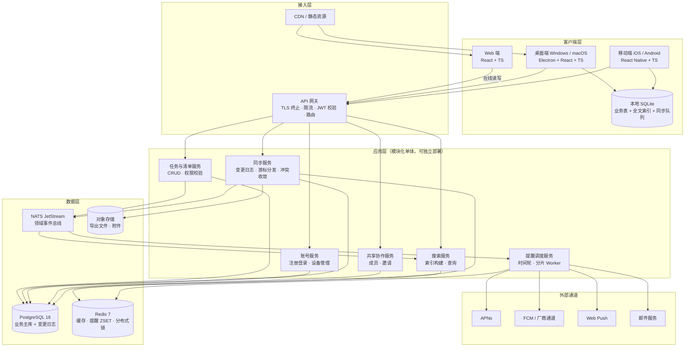
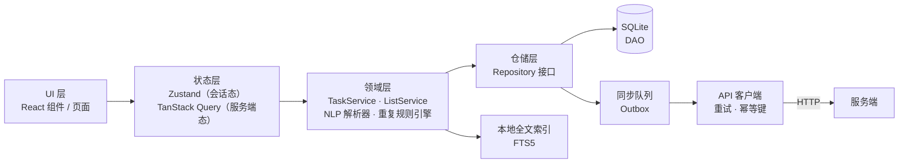
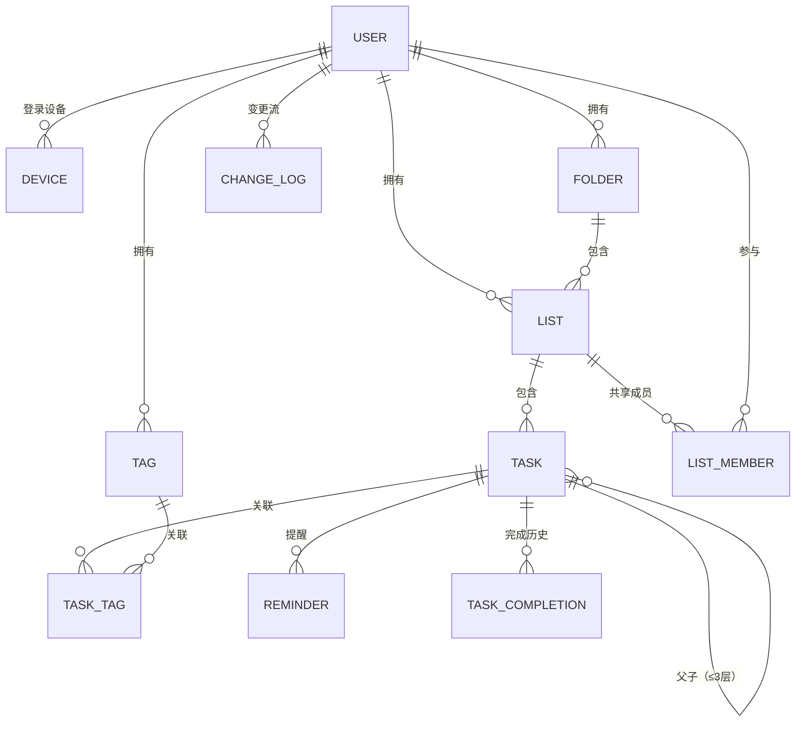
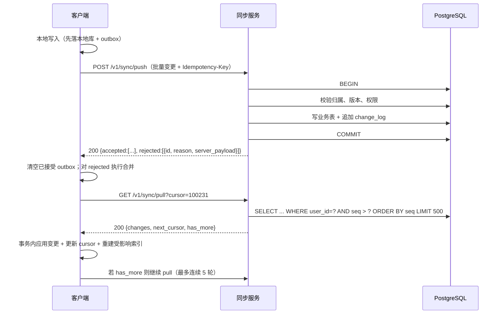
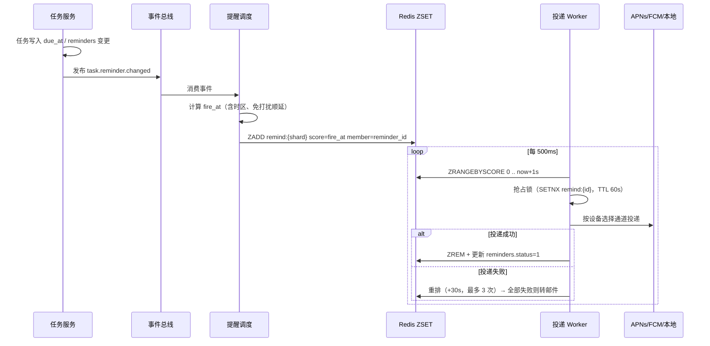
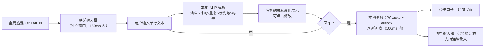
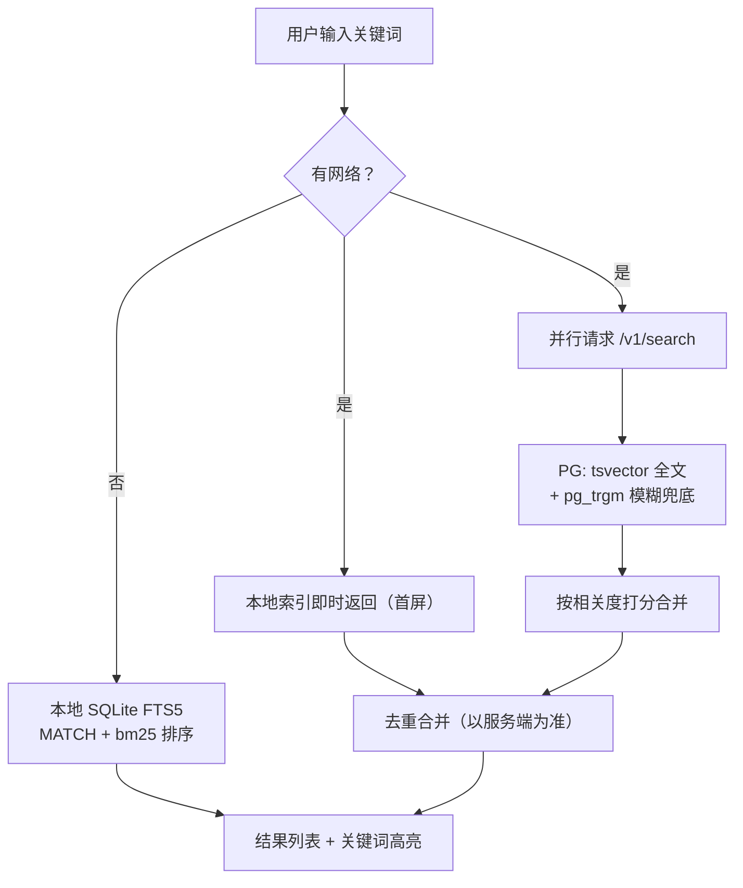
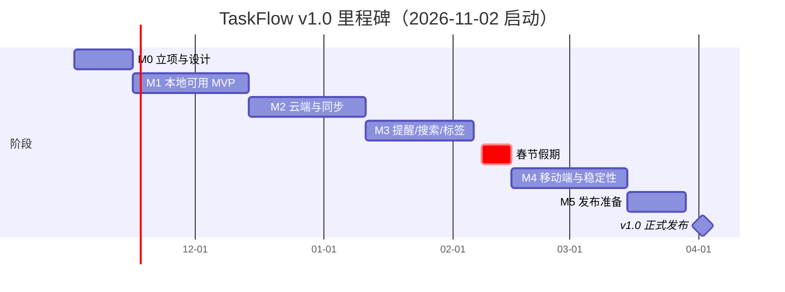
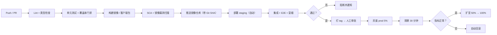

# TaskFlow 任务管理应用 — 项目文档

| 项目 | 内容 |
|---|---|
| 项目名称 | TaskFlow（跨平台任务管理应用） |
| 项目代号 | TF |
| 文档版本 | v1.0 |
| 文档状态 | 已评审 / 可执行 |
| 编写日期 | 2026-10-31 |
| 适用读者 | 产品、UI/UX、客户端开发、服务端开发、测试、运维 |
| 目标版本 | v1.0.0（首个正式发布版本） |
| 关联文档 | 《交互设计稿》《接口契约（OpenAPI）》《测试用例库》 |

> 阅读约定：本文中所有需求编号（如 `FR-TASK-03`、`NFR-PERF-02`）为唯一标识，需求变更须引用编号。术语表见附录 A，全文术语以附录 A 为准。

---

## 目录

1. [项目概述与目标用户](#1-项目概述与目标用户)
2. [核心功能范围](#2-核心功能范围)
3. [非功能需求](#3-非功能需求)
4. [系统架构与技术选型](#4-系统架构与技术选型)
5. [主要模块与数据模型](#5-主要模块与数据模型)
6. [接口与关键流程](#6-接口与关键流程)
7. [开发与迭代计划](#7-开发与迭代计划)
8. [测试与验收标准](#8-测试与验收标准)
9. [部署与维护](#9-部署与维护)
10. [附录](#10-附录)

---

## 1. 项目概述与目标用户

### 1.1 项目背景

现有任务管理工具在中文用户场景下普遍存在三类问题：

1. **录入成本高**：创建一条带时间、清单、标签的任务平均需要 4～6 次点击，用户在"想到"和"记下"之间流失。
2. **离线不可用**：弱网或断网时列表不可读、不可写，通勤、出差场景直接失效。
3. **提醒不可靠**：依赖单一推送通道，系统清理后台后提醒大面积丢失，用户对工具失去信任。

TaskFlow 以"**三秒记下、永不丢失、准时提醒**"为核心价值主张，构建一个离线优先（Offline-First）的跨平台任务管理应用。

### 1.2 产品定位

> 一句话定位：面向中文个人用户与小团队的、离线可用、提醒可靠的跨平台任务管理工具。

- **产品形态**：Windows / macOS 桌面端 + Web 端 + iOS / Android 移动端，四端数据实时同步。
- **核心差异点**：本地优先架构（断网全功能可用）、中文自然语言快速创建、多通道冗余提醒。
- **不追求**：重型项目管理（甘特图、资源负载、工时核算），该类需求由专业 PM 工具承接。

### 1.3 目标用户

| 用户画像 | 典型特征 | 核心诉求 | 使用频次 |
|---|---|---|---|
| **P1 职场个人**（主要） | 25～40 岁，知识工作者，日均 15～40 条任务，PC 为主、手机为辅 | 会议待办不遗漏、跨设备无缝、与邮件/日历配合 | 每天 8～20 次 |
| **P2 学生**（次要） | 18～24 岁，课程/作业/考试节点密集，手机为主 | 按课程分组、倒计时提醒、周期任务 | 每天 3～8 次 |
| **P3 自由职业 / 3～10 人小团队**（扩展） | 需要把任务分派给协作者，但不需要完整项目管理 | 共享清单、任务指派、完成状态可见 | 每天 5～15 次 |

**非目标用户**：50 人以上组织的项目集管理、需要审批流与工时报表的企业客户（v1.0 明确不支持，见 1.7）。

### 1.4 典型使用场景

**场景 A｜会议中快速记录（P1）**
用户在视频会议中按 `Ctrl+Alt+N` 唤起全局快速输入框，输入"周五前给张总反馈预算方案 #工作 !高 @财务"，回车即完成创建。系统自动解析出截止日期（本周五 18:00）、标签（工作、财务）、优先级（高），用户无需离开会议窗口。

**场景 B｜地铁通勤离线整理（P2）**
用户在地铁无网络环境下打开手机端，看到昨日已同步的全部任务，勾选完成 3 条、新增 2 条、把 1 条改期到明天。出站恢复网络后 2 秒内自动同步，PC 端同时更新。

**场景 C｜多端接力（P1）**
用户在 PC 端把任务"整理季度复盘材料"拆成 5 个子任务并设置今天 20:00 提醒，19:55 手机弹出提醒（PC 已关机），点击通知直达该任务。

### 1.5 竞品对比与差异化

| 维度 | TaskFlow 目标 | 滴答清单 | Todoist | Microsoft To Do |
|---|---|---|---|---|
| 离线全功能 | ✅ 本地优先 | 部分 | 部分 | 部分 |
| 中文自然语言解析 | ✅ 一等公民 | ✅ | 一般 | 弱 |
| 提醒可靠性（多通道冗余） | ✅ 三通道 | 中 | 中 | 中 |
| 桌面快速唤起 | ✅ 全局热键 + 托盘常驻 | ✅ | 弱 | 弱 |
| 协作能力 | 轻量共享清单 | 中 | 中 | 中 |
| 数据导出 | ✅ 全量 JSON / CSV | ✅ | ✅ | 部分 |

### 1.6 产品目标与衡量指标

**北极星指标**：周活跃用户的人均"完成任务数"（Weekly Completed Tasks per WAU）。

| 指标 | 定义 | v1.0 目标 | 观测方式 |
|---|---|---|---|
| 次日留存 | D1 回访用户 / 新增用户 | ≥ 40% | 埋点 |
| 7 日留存 | D7 回访用户 / 新增用户 | ≥ 22% | 埋点 |
| 人均周完成任务 | 完成任务数 / WAU | ≥ 12 | 埋点 |
| 快速创建使用率 | 使用自然语言创建的用户占比 | ≥ 60% | 埋点 |
| 同步失败率 | 同步请求失败 / 总同步请求 | ≤ 0.05% | 服务端监控 |
| 提醒准时率 | 60s 内送达 / 应送达 | ≥ 99.9% | 提醒服务监控 |
| 崩溃率 | 崩溃会话 / 总会话 | ≤ 0.1% | 客户端 APM |

### 1.7 版本范围边界

**v1.0 包含**：任务与子任务、清单分组、优先级、提醒与截止日期、重复规则、标签、搜索、多端增量同步、共享清单（邀请制，≤ 10 人）。

**v1.0 明确不做**（列入后续版本池）：

- 甘特图、看板拖拽看板视图（v1.1）
- 番茄钟 / 习惯打卡（v1.1）
- 日历双向同步（Google / Outlook，v1.2）
- 附件上传与全文检索（v1.2）
- 语音输入、AI 任务拆解（v1.3）
- 企业组织架构、审批流、工时报表（不在路线图内）

---

## 2. 核心功能范围

### 2.1 功能结构总览

| 模块 | 功能编号段 | 说明 | 优先级 |
|---|---|---|---|
| 任务创建与分组 | FR-TASK | 任务 CRUD、子任务、快速创建、自然语言解析、批量操作 | P0 |
| 清单管理 | FR-LIST | 清单 CRUD、分组文件夹、排序、归档、共享 | P0 |
| 优先级 | FR-PRIO | 四级优先级、排序权重、筛选 | P0 |
| 提醒与截止日期 | FR-REMIND | 截止时间、提醒规则、重复规则、通知投递 | P0 |
| 标签 | FR-TAG | 标签 CRUD、多标签、着色、筛选 | P1 |
| 搜索 | FR-SEARCH | 关键词搜索、组合筛选、排序、历史记录 | P0 |
| 同步 | FR-SYNC | 增量同步、冲突解决、离线队列 | P0 |
| 账号 | FR-AUTH | 注册登录、多设备管理、数据导出 | P0 |

优先级定义：**P0** = v1.0 必须交付，缺失则不可发布；**P1** = v1.0 应交付，可降级为 v1.0.x；**P2** = 可延后。

---

### 2.2 任务创建与分组（FR-TASK）

#### 2.2.1 需求明细

| 编号 | 需求 | 优先级 | 验收要点 |
|---|---|---|---|
| FR-TASK-01 | 创建任务：标题必填（1～512 字符），支持备注（Markdown，≤ 20,000 字符）、截止时间、优先级、标签、清单归属 | P0 | 空标题提交被拦截并给出提示；超长输入被截断并提示 |
| FR-TASK-02 | 快速创建：全局热键 `Ctrl+Alt+N`（macOS `⌘⌥N`）唤起输入框，输入即创建，不打开主窗口；`Esc` 关闭 | P0 | 热键在任意前台应用下可用；唤起耗时 ≤ 150ms |
| FR-TASK-03 | 自然语言解析：从单行文本识别日期、时间、重复规则、优先级、标签、清单 | P0 | 20 条标准语料解析准确率 ≥ 95%（见 8.2） |
| FR-TASK-04 | 子任务：最多 3 层嵌套；父任务显示子任务完成进度（如 2/5） | P0 | 第 4 层创建被拒绝并提示 |
| FR-TASK-05 | 任务完成：单击复选框标记完成，记录完成时间；支持撤销（5 秒内 Toast 撤销） | P0 | 完成后任务移入"已完成"分组；撤销后状态与完成时间完全还原 |
| FR-TASK-06 | 任务删除：软删除（墓碑），保留 30 天可在"回收站"恢复 | P0 | 删除后列表不可见、搜索不可见；恢复后数据完整 |
| FR-TASK-07 | 任务编辑：支持从任务详情面板编辑全部字段，编辑自动保存（防抖 800ms） | P0 | 关闭面板不丢失编辑内容；并发编辑以 6.4 冲突策略处理 |
| FR-TASK-08 | 任务排序：在同一清单内拖拽排序，位置持久化 | P0 | 排序在四端一致；插入 1000 条任务后排序操作 P95 ≤ 100ms |
| FR-TASK-09 | 批量操作：多选后批量完成 / 删除 / 移动清单 / 设置优先级 / 加标签 | P1 | 单次最多 200 条；失败条目单独回报 |
| FR-TASK-10 | 任务复制：复制任务（含子任务、标签，不含提醒历史） | P2 | 复制后新 ID，原任务不变 |

#### 2.2.2 任务字段定义

| 字段 | 类型 | 必填 | 默认值 | 说明 |
|---|---|---|---|---|
| id | UUID v7 | 是 | 客户端生成 | 全局唯一，离线可创建 |
| list_id | UUID | 是 | 收件箱 | 所属清单 |
| parent_id | UUID | 否 | null | 父任务 ID，用于子任务 |
| title | string(512) | 是 | — | 任务标题 |
| content | text | 否 | 空 | Markdown 备注 |
| status | enum | 是 | `todo` | `todo` / `done` / `canceled` |
| priority | enum | 是 | `none` | `none` / `low` / `medium` / `high` / `urgent` |
| due_at | timestamptz | 否 | null | 具体截止时刻（含时区） |
| is_all_day | bool | 是 | false | true 时按 `due_date` 全天处理 |
| due_date | date | 否 | null | 全天截止日期 |
| timezone | string(64) | 是 | 用户默认时区 | IANA 时区名，如 `Asia/Shanghai` |
| recurrence_rule | string(1024) | 否 | null | RFC 5545 RRULE |
| recurrence_until | timestamptz | 否 | null | 重复结束时间 |
| sort_order | string(64) | 是 | LexoRank | 清单内排序键 |
| completed_at | timestamptz | 否 | null | 完成时刻 |
| created_at / updated_at | timestamptz | 是 | 服务端时间 | — |
| deleted_at | timestamptz | 否 | null | 软删除标记 |
| version | int64 | 是 | 1 | 乐观锁版本号 |

> 一致性要求：`due_at` 与 `due_date` 同一时刻仅一个有效；`is_all_day = true` 时必须写 `due_date`，`due_at` 为空。

#### 2.2.3 自然语言解析规则

支持的中文表达（示例，完整语料见《测试用例库/NLP 语料集》）：

| 类别 | 支持的表达 |
|---|---|
| 日期 | 今天、明天、后天、大后天、下周一、本周五、3 天后、11 月 5 日、11/5、月底、下个月 3 号 |
| 时间 | 上午 9 点、下午 3 点半、晚上 8 点、15:30、9am、中午、傍晚 |
| 重复 | 每天、每个工作日、每周一、每月 1 号、每两周、每年 10 月 31 日 |
| 优先级 | `!高` `!中` `!低` `!紧急` 或 `!!` `!!!` |
| 标签 | `#标签名` 或 `@标签名` |
| 清单 | 文本前缀 `[清单名]` 或后缀「放进『清单名』」 |

解析规则：

1. 解析在**客户端本地**完成（内置词法 + 规则引擎），不依赖网络；无法解析时静默降级为纯标题，不做错误提示。
2. 解析结果在输入框下方以**可点击胶囊**展示，用户可点击修改，修改后不回写标题文本。
3. 识别顺序：清单 > 时间 > 重复 > 优先级 > 标签。**未加 `#`/`@` 前缀的连续中文不识别为标签**，避免误伤标题。

---

### 2.3 清单管理（FR-LIST）

| 编号 | 需求 | 优先级 | 验收要点 |
|---|---|---|---|
| FR-LIST-01 | 内置清单「收件箱」：不可删除、不可重命名，默认归属 | P0 | 删除按钮不出现；任务移入收件箱可用 |
| FR-LIST-02 | 清单 CRUD：名称（1～64 字符）、颜色（12 色板）、图标（可选 40 个内置图标） | P0 | 重名允许但给出提示；改名后历史任务不受影响 |
| FR-LIST-03 | 清单文件夹分组：文件夹可包含多个清单，最多 2 层（文件夹 → 清单 → 任务） | P0 | 第 3 层创建被拒绝 |
| FR-LIST-04 | 清单排序：拖拽调整清单与文件夹顺序 | P0 | 排序跨端一致 |
| FR-LIST-05 | 清单归档：归档后不出现在侧栏，任务只读；可恢复 | P1 | 归档清单的任务不参与"今日待办"统计 |
| FR-LIST-06 | 清单删除：清单下任务需用户确认处理方式（一并删除 / 迁移到收件箱） | P0 | 未确认时不执行删除 |
| FR-LIST-07 | 共享清单：邀请成员（邮箱/账号），角色为「可编辑 / 只读」；成员上限 10 人 | P1 | 只读成员的所有写操作被服务端拒绝（403） |
| FR-LIST-08 | 清单统计：显示未完成任务数与今日到期数 | P1 | 数字与列表实际条数一致，误差为 0 |

---

### 2.4 优先级（FR-PRIO）

| 编号 | 需求 | 优先级 | 验收要点 |
|---|---|---|---|
| FR-PRIO-01 | 四级优先级 + 无优先级：`urgent`(红) / `high`(橙) / `medium`(蓝) / `low`(灰) / `none` | P0 | 五档在四端颜色与图标一致 |
| FR-PRIO-02 | 快速切换：任务行右键菜单 / 详情面板内一键切换 | P0 | 切换后 200ms 内 UI 反馈，异步落库 |
| FR-PRIO-03 | 优先级参与默认排序：优先级降序 → 截止时间升序 → 创建时间升序 | P0 | 排序规则在文档、代码、测试三处一致 |
| FR-PRIO-04 | 优先级筛选：可多选优先级过滤列表 | P1 | 与标签、时间筛选可叠加（AND 关系） |

> 注：v1.0 采用**单维优先级**，不引入"重要性/紧急度"二维四象限模型（四象限为 v1.1 视图能力，数据层预留 `importance` 字段但 UI 不暴露）。

---

### 2.5 提醒与截止日期（FR-REMIND）

| 编号 | 需求 | 优先级 | 验收要点 |
|---|---|---|---|
| FR-REMIND-01 | 设置截止时间：支持精确到分钟的时刻，或全天日期 | P0 | 全天任务在当天 09:00 汇总提醒 |
| FR-REMIND-02 | 提醒规则：截止时、提前 5 分钟 / 15 分钟 / 30 分钟 / 1 小时 / 1 天 / 自定义（1 分钟～30 天） | P0 | 可叠加多条提醒（单任务 ≤ 5 条） |
| FR-REMIND-03 | 重复任务：支持每天 / 工作日 / 每周指定星期 / 每月指定日 / 每年 / 每 N 天 | P0 | 完成一个周期实例后自动生成下一实例 |
| FR-REMIND-04 | 重复任务完成语义：完成当前实例 → 生成下一实例（沿用原任务 ID 的"滚动实例"模型） | P0 | 历史完成记录可在"已完成"中查到 |
| FR-REMIND-05 | 多通道投递：APNs（iOS）/ FCM（Android）/ Web Push / 桌面本地通知 | P0 | 任一通道失败自动降级到下一通道 |
| FR-REMIND-06 | 提醒可靠性：设备离线超过阈值时，恢复联网后补发未过期提醒（补发窗口 10 分钟） | P0 | 离线 3 小时后上线，仅补发 10 分钟内应到的提醒 |
| FR-REMIND-07 | 稍后提醒（Snooze）：通知上支持 10 分钟 / 1 小时 / 明天 09:00 | P1 | 同一任务 Snooze 次数 ≤ 5 |
| FR-REMIND-08 | 免打扰时段：用户可设置不投递时间段（如 22:00–08:00），到期提醒顺延至时段结束 | P1 | 免打扰内不产生推送；顺延提醒标记 `deferred=true` |
| FR-REMIND-09 | 时区处理：跨时区旅行时，绝对时刻任务按 `due_at` 绝对时间提醒；全天任务按用户当前时区 | P0 | 时区切换后全天任务提醒时间正确 |

**重复规则存储规范**：使用 RFC 5545 RRULE 字符串，例：`FREQ=WEEKLY;BYDAY=MO,WE,FR`。不自定义私有格式，便于后续与日历系统互通。

---

### 2.6 标签（FR-TAG）

| 编号 | 需求 | 优先级 | 验收要点 |
|---|---|---|---|
| FR-TAG-01 | 标签 CRUD：名称（1～32 字符，全局唯一，不区分大小写）、颜色（12 色板） | P1 | 创建重复标签时返回已有标签而非报错 |
| FR-TAG-02 | 多标签：单任务最多 10 个标签 | P0 | 第 11 个被拒绝并提示 |
| FR-TAG-03 | 标签筛选：支持单标签筛选与多标签筛选（多标签为"任一命中"，可切换为"全部命中"） | P1 | 两种模式切换后结果正确 |
| FR-TAG-04 | 标签重命名与合并：合并时自动迁移关联任务 | P1 | 合并后无孤儿关联记录 |
| FR-TAG-05 | 标签统计：显示每个标签下未完成任务数 | P2 | 与筛选结果条数一致 |

---

### 2.7 搜索（FR-SEARCH）

| 编号 | 需求 | 优先级 | 验收要点 |
|---|---|---|---|
| FR-SEARCH-01 | 关键词搜索：匹配标题与备注，支持中英文混合 | P0 | 10 万条任务下 P95 ≤ 300ms |
| FR-SEARCH-02 | 搜索即时性：输入 300ms 防抖后触发，结果流式返回 | P0 | 首字符到首屏结果 ≤ 500ms（本地索引） |
| FR-SEARCH-03 | 组合筛选：清单 / 标签 / 优先级 / 状态 / 时间范围（今天、本周、逾期、无日期）可叠加 | P0 | 筛选条件在 URL 中可序列化，可分享与回退 |
| FR-SEARCH-04 | 结果排序：相关度 / 截止时间 / 创建时间 / 优先级，可切换 | P1 | 相关度排序规则见 6.7 |
| FR-SEARCH-05 | 搜索历史：本地保留最近 10 条，可单条删除与清空 | P1 | 历史不上传服务端 |
| FR-SEARCH-06 | 高亮命中片段：结果中高亮关键词，备注命中时展示上下文 30 字 | P1 | 中文分词边界内高亮，不切断词语 |
| FR-SEARCH-07 | 离线搜索：断网时可搜索本地全部已同步数据 | P0 | 与在线结果一致率 100%（全量已同步前提下） |

---

### 2.8 账号与权限（FR-AUTH）

| 编号 | 需求 | 优先级 | 验收要点 |
|---|---|---|---|
| FR-AUTH-01 | 注册登录：邮箱 + 验证码 / 密码；支持第三方登录（微信 / Apple） | P0 | 登录态有效期：Access Token 15 分钟，Refresh Token 30 天滚动 |
| FR-AUTH-02 | 多设备管理：查看已登录设备列表，可远程登出 | P1 | 远程登出后该设备 1 分钟内同步请求返回 401 |
| FR-AUTH-03 | 数据导出：全量导出 JSON（含清单、任务、标签、子任务关系） | P0 | 导出的 JSON 可被导入功能完整还原 |
| FR-AUTH-04 | 账号注销：二次确认 + 7 天冷静期，到期物理删除 | P0 | 冷静期内可撤销；到期后数据不可恢复 |

**权限模型（v1.0）**：

| 对象 | 所有者 | 共享可编辑成员 | 共享只读成员 |
|---|---|---|---|
| 清单 | 增删改 + 共享管理 | 增删改清单内任务、改清单名 | 仅读 |
| 任务 | 增删改 | 增删改 | 仅读 |
| 标签 | 增删改 | 仅使用（不可删改他人标签） | 仅读 |

---

### 2.9 功能优先级总览（MoSCoW）

| 级别 | 内容 |
|---|---|
| Must have | 任务 CRUD、快速创建、自然语言解析、清单管理、优先级、提醒与重复、搜索、增量同步、离线可用 |
| Should have | 标签、共享清单、批量操作、稍后提醒、免打扰、清单统计 |
| Could have | 任务复制、标签合并、搜索历史、清单归档 |
| Won't have（v1.0） | 看板/甘特、附件、日历双向同步、AI 拆解、组织与审批 |

---

## 3. 非功能需求

### 3.1 性能（NFR-PERF）

| 编号 | 指标 | 目标值 | 测量条件 |
|---|---|---|---|
| NFR-PERF-01 | 客户端冷启动到可交互 | ≤ 2.5s（Win/macOS，SSD，8GB 内存）；≤ 1.2s（移动端） | 应用首次启动、本地库已有 1 万条任务 |
| NFR-PERF-02 | 任务列表首屏渲染 | ≤ 800ms（读本地缓存，不等网络） | 1 万条任务 |
| NFR-PERF-03 | 列表滚动帧率 | ≥ 55 FPS（桌面）/ ≥ 50 FPS（移动中端机） | 1 万条任务虚拟滚动 |
| NFR-PERF-04 | 任务创建到 UI 可见 | ≤ 100ms（本地写入后即渲染，网络异步） | 任意网络状态 |
| NFR-PERF-05 | 读接口服务端耗时 | P95 ≤ 200ms，P99 ≤ 500ms | 单用户 ≤ 5 万任务 |
| NFR-PERF-06 | 写接口服务端耗时 | P95 ≤ 300ms，P99 ≤ 800ms | 峰值 QPS 的 80% |
| NFR-PERF-07 | 搜索响应 | P95 ≤ 300ms（服务端）/ ≤ 100ms（本地索引） | 单用户 10 万任务 |
| NFR-PERF-08 | 增量同步单轮耗时 | 200 条变更 ≤ 1.5s | 4G 网络 |
| NFR-PERF-09 | 多端同步端到端延迟 | P95 ≤ 3s（一端写入到另一端可见） | 双端在线 |
| NFR-PERF-10 | 提醒投递准时率 | ≥ 99.9% 在应到时间 ±30s 内送达 | 全量提醒样本 |
| NFR-PERF-11 | 客户端常驻内存 | 桌面 ≤ 350MB，移动 ≤ 180MB | 1 万条任务、常驻 8 小时 |
| NFR-PERF-12 | 安装包体积 | Windows ≤ 120MB，macOS ≤ 130MB，移动 ≤ 60MB | 正式包 |

### 3.2 规模与容量假设（NFR-SCALE）

| 维度 | v1.0 设计假设 | 上限设计 |
|---|---|---|
| 注册用户 | 10 万 | 100 万 |
| 日活用户（DAU） | 2 万 | 20 万 |
| 峰值写 QPS | 500 | 3000 |
| 峰值读 QPS | 3000 | 20000 |
| 单用户任务数 | 2 万 | 20 万 |
| 单用户清单数 | 50 | 200 |
| 单用户标签数 | 50 | 300 |
| 待调度提醒总量 | 500 万（未来 90 天） | 5000 万 |
| 附件存储（v1.2） | — | 不适用 |

### 3.3 数据同步与存储（NFR-SYNC / NFR-DATA）

| 编号 | 需求 |
|---|---|
| NFR-SYNC-01 | **离线优先**：所有读写先落本地库，网络可用时异步同步；断网状态下全部功能（除共享协作与登录）可用 |
| NFR-SYNC-02 | **最终一致**：任意设备在停止操作后，30s 内与其他设备状态收敛一致 |
| NFR-SYNC-03 | **增量同步**：客户端通过单调递增游标（cursor）拉取变更，不进行全量轮询；单轮最多返回 500 条变更，超出分页 |
| NFR-SYNC-04 | **幂等**：相同请求重复提交（含网络重试）结果一致，依赖客户端生成的 `entity_id` + `Idempotency-Key` |
| NFR-SYNC-05 | **冲突解决**：字段级 Last-Write-Wins（服务端混合逻辑时钟 HLC 比较），详见 6.4.3 |
| NFR-SYNC-06 | **不丢失**：客户端离线队列持久化，应用崩溃/重启后继续同步；队列条目保留至服务端确认 |
| NFR-SYNC-07 | **墓碑机制**：删除以 `deleted_at` 墓碑同步，墓碑保留 90 天后物理清理；客户端不得因墓碑缺失而"复活"数据 |
| NFR-DATA-01 | 服务端主存储：PostgreSQL，开启 WAL 归档，PITR 可恢复到任意 5 分钟前时间点 |
| NFR-DATA-02 | 客户端本地存储：SQLite（桌面）/ SQLite（移动），全文索引与业务表同库 |
| NFR-DATA-03 | 数据隔离：所有业务查询必须带 `user_id` 条件，通过行级安全策略（RLS）二次兜底 |
| NFR-DATA-04 | 数据加密：传输 TLS 1.2+；服务端静态加密（云盘加密）；本地库对 `content` 字段做应用层加密（密钥存系统钥匙串/凭据管理器） |

### 3.4 兼容性（NFR-COMPAT）

| 编号 | 平台 | 支持范围 |
|---|---|---|
| NFR-COMPAT-01 | Windows | Windows 10 1809 及以上、Windows 11 全版本；x64 与 ARM64 |
| NFR-COMPAT-02 | macOS | macOS 12 Monterey 及以上；Apple Silicon 原生 + Intel |
| NFR-COMPAT-03 | iOS | iOS 15.0 及以上，iPhone / iPad 自适应布局 |
| NFR-COMPAT-04 | Android | Android 9.0 (API 28) 及以上，覆盖主流厂商 ROM |
| NFR-COMPAT-05 | Web | Chrome / Edge 100+，Safari 15+，Firefox 100+；不支持 IE |
| NFR-COMPAT-06 | 显示 | 最小 1024×640 逻辑分辨率；支持 100%～250% 缩放；高 DPI 图标清晰 |
| NFR-COMPAT-07 | 输入 | 中文输入法（微软拼音 / 搜狗 / 百度）候选框不遮挡输入位置；支持键盘全操作（Tab 焦点序、快捷键） |
| NFR-COMPAT-08 | 主题 | 浅色 / 深色 / 跟随系统，切换无闪烁 |
| NFR-COMPAT-09 | 无障碍 | 关键流程满足 WCAG 2.1 AA：对比度 ≥ 4.5:1、可聚焦、屏幕阅读器可朗读任务状态 |
| NFR-COMPAT-10 | 国际化 | v1.0 仅简体中文；文案全部走 i18n key，不硬编码 |

### 3.5 安全与隐私（NFR-SEC）

| 编号 | 需求 |
|---|---|
| NFR-SEC-01 | 认证：JWT（RS256），Access Token 15 分钟，Refresh Token 30 天且每次刷新轮换（Refresh Token Rotation），旧 Token 立即失效 |
| NFR-SEC-02 | 传输：强制 HTTPS，HSTS 开启，禁止明文 HTTP |
| NFR-SEC-03 | 存储：密码使用 Argon2id（m=64MB, t=3, p=4）；不存储明文凭证 |
| NFR-SEC-04 | 越权防护：所有资源访问校验 `user_id` 归属；共享清单校验成员角色；越权统一返回 404（不泄露资源存在性） |
| NFR-SEC-05 | 限流：单用户 600 请求/分钟，单 IP 3000 请求/分钟；登录接口 5 次/分钟/IP，超限返回 429 |
| NFR-SEC-06 | 审计：登录、导出、注销、共享邀请等敏感操作写入审计日志，保留 180 天 |
| NFR-SEC-07 | 依赖安全：CI 集成 SCA 扫描（SCA + 许可证扫描），高危漏洞阻断合并 |
| NFR-SEC-08 | 隐私：仅采集必要的埋点；埋点不包含任务标题与备注正文；用户可关闭行为埋点 |

### 3.6 可用性与可维护性（NFR-AVAIL）

| 编号 | 需求 |
|---|---|
| NFR-AVAIL-01 | 服务端可用性 SLO：月度 99.9%（单次不可用 ≤ 5 分钟计入故障） |
| NFR-AVAIL-02 | 故障隔离：同步服务、提醒服务、搜索服务互相独立部署，单模块故障不导致全站不可用；客户端在读缓存下仍可用 |
| NFR-AVAIL-03 | 可观测性：全链路 Trace（OpenTelemetry），关键路径埋点覆盖率 100%，日志结构化（JSON） |
| NFR-AVAIL-04 | 可维护性：核心逻辑单元测试覆盖率 ≥ 80%；接口变更遵循语义化版本，废弃接口保留 2 个大版本 |
| NFR-AVAIL-05 | 交付：任一服务可在 10 分钟内完成回滚 |

### 3.7 合规（NFR-COMPLIANCE）

- 遵循《个人信息保护法》：明示收集范围、提供数据导出与注销、最小化采集。
- 移动端上架需完成 App 备案、隐私政策弹窗（首次启动前）、权限使用说明。
- 推送内容不含敏感信息明文（通知栏仅显示"你有 1 条任务到期"，正文在应用内展示，可由用户开启全文）。

---

## 4. 系统架构与技术选型

### 4.1 架构原则

1. **本地优先（Offline-First）**：本地库是读取的唯一数据源，网络是同步通道。
2. **单一写入路径**：所有变更先写本地，再由同步引擎提交服务端，杜绝"双写"。
3. **服务无状态**：业务服务不保存会话状态，水平扩容无差别。
4. **契约先行**：接口以 OpenAPI 为准，客户端 SDK 由契约生成，禁止手写模型。
5. **渐进演进**：初期用单体 + 模块化，达到拆分阈值（见 4.6 ADR-3）再拆微服务。

### 4.2 总体架构



**分层职责**

| 层 | 职责 | 关键约束 |
|---|---|---|
| 客户端层 | 本地读写、UI 渲染、离线队列、本地搜索 | 不直连数据库，不信任网络 |
| 接入层 | 认证、限流、路由、灰度分流 | 无业务逻辑 |
| 应用层 | 领域逻辑、事务、事件发布 | 单服务单写库，跨服务只通过事件 |
| 数据层 | 持久化、缓存、消息 | 主库是唯一真相源（Source of Truth） |
| 外部通道 | 通知投递 | 通道失败必须降级，不得阻塞业务 |

### 4.3 客户端架构



**目录结构约定**（桌面/Web 共用）

```
apps/
  desktop/            Electron 主进程（托盘、全局热键、通知、自动更新）
  web/                Web 入口
  mobile/             React Native 入口
packages/
  ui/                 设计系统组件（跨端复用，RN 侧通过适配层）
  domain/             领域模型与业务规则（纯 TS，零平台依赖）
  data/               仓储接口 + SQLite 实现 + 同步引擎
  api-client/         OpenAPI 生成的客户端
  nlp/                自然语言解析引擎（纯函数，可单测）
  config/             lint / tsconfig / 构建脚本
```

**关键约束**

- `packages/domain` 不得引入任何平台 API（window、fs、RN 模块），保证可在 Node 环境单测。
- 所有 UI 状态变更通过领域层方法（如 `taskService.complete(id)`），禁止组件直接操作 SQLite。
- 桌面主进程与渲染进程通过受限 IPC（白名单 channel）通信，渲染进程 `nodeIntegration = false`、`contextIsolation = true`。

### 4.4 服务端架构

**形态**：模块化单体（Modular Monolith），单仓库、单镜像、单进程内多模块；按模块边界划分包，禁止跨模块直接访问对方数据表。

| 模块 | 核心职责 | 主要依赖 |
|---|---|---|
| account | 注册、登录、Token、设备、导出、注销 | PG、Redis、邮件 |
| task | 任务 / 子任务 / 标签 / 清单 CRUD | PG |
| sync | 变更日志写入、游标分发、批量 push 收敛 | PG、Redis、NATS |
| reminder | 提醒注册、时间轮调度、通道分发、重试 | Redis ZSET、NATS、APNs/FCM |
| search | 索引增量更新、查询编排、相关度排序 | PG（v1.0 用 PG 全文 + pg_trgm） |
| share | 共享清单成员与权限 | PG |

**同步写入路径**（所有写操作的统一出口）

```
客户端 HTTP 请求
  → 网关（鉴权、限流）
  → 模块 Handler（参数校验）
  → 领域 Service（业务规则）
  → 事务：写业务表 + 追加 change_log（同事务）
  → 提交后异步发布 NATS 事件（提醒注册 / 索引更新）
  → 返回 200 + 最新 version
```

> 硬性要求：`change_log` 追加必须与业务写入在**同一数据库事务**内，禁止异步补写，否则会出现"改了但没同步"。

### 4.5 技术选型

| 层次 | 选型 | 版本 | 理由 | 备选（未采用原因） |
|---|---|---|---|---|
| 桌面端外壳 | Electron | 33.x | 团队现有经验；托盘、全局热键、系统通知、自动更新生态成熟 | Tauri 2（体积更小，但 Rust 侧插件与多窗口能力需自建，v2.0 再评估） |
| 前端框架 | React + TypeScript | 18 / 5.x | 与移动端共享领域层；类型安全 | Vue 3（团队经验次之） |
| 构建 | Vite | 5.x | 构建快、HMR 稳定 | Webpack（配置成本高） |
| 客户端状态 | Zustand + TanStack Query | 4 / 5 | 会话态与服务端态分离，避免全局 store 膨胀 | Redux Toolkit（样板代码多） |
| 本地数据库 | SQLite（better-sqlite3 / expo-sqlite） | 3.45+ | 事务、FTS5 全文、跨端一致 | Realm（MongoDB 生态变动风险）、IndexedDB（桌面场景性能不足） |
| 移动端 | React Native | 0.76 | 复用 domain / data / api-client 层 | Flutter（Dart 无法复用 TS 领域层，双份逻辑） |
| 服务端语言 | Go | 1.23 | 高并发同步场景表现稳；部署为单二进制；GC 延迟可控 | Node/NestJS（同栈开发快，但同步长连接与 CPU 密集解析场景弱）、Java（团队规模不匹配） |
| Web 框架 | Gin + 自研中间件 | 1.10 | 轻量、路由清晰 | 无 |
| 主数据库 | PostgreSQL | 16 | 事务强、JSONB 灵活、RLS、全文检索可用 | MySQL（全文与 JSON 能力弱） |
| 缓存 / 队列辅助 | Redis | 7.2 | 提醒 ZSET、分布式锁、热点缓存 | 无 |
| 事件总线 | NATS JetStream | 2.10 | 轻量、运维简单、支持持久化与重放 | Kafka（3 节点起步成本高，v1.0 规模不需要） |
| 搜索 | PostgreSQL FTS + pg_trgm + zhparser 分词 | — | 10 万任务量级无需独立引擎，减少运维面 | OpenSearch（运维重，留作规模阈值触发后的替换项） |
| 对象存储 | S3 兼容（云 OSS） | — | 导出文件、后续附件 | — |
| 推送 | APNs / FCM + 国内厂商通道（小米/华为/OPPO/vivo） | — | 覆盖国内机型后台限制 | 仅 FCM（国内到达率不可接受） |
| 监控 | Prometheus + Grafana + Loki + OpenTelemetry | — | 开源、成本低、指标日志链路打通 | 商业 APM（预算） |
| 客户端崩溃 | Sentry（自托管） | — | 符号表上传友好 | — |
| CI/CD | GitHub Actions + Argo CD | — | 与应用代码同仓，GitOps 回滚快 | Jenkins（维护成本） |
| 基础设施 | Kubernetes（生产）/ Docker Compose（开发） | — | 灰度与弹性 | 纯虚拟机（扩容慢） |
| 客户端分发 | Windows：MSIX + 自更新；macOS：DMG + 公证；移动：应用商店 | — | 覆盖企业内网与商店双渠道 | — |

### 4.6 关键技术决策（ADR）

**ADR-1｜采用本地优先架构，而非"在线优先 + 缓存"**

- 决策：客户端本地 SQLite 为读取唯一数据源，写入先落本地再同步。
- 理由：核心卖点是不丢任务；弱网/断网是高频场景。
- 代价：必须实现同步引擎与冲突解决，客户端复杂度上升约 30%。
- 影响：`domain` 层所有方法签名必须支持"无网络"执行，禁止在 UI 中 await 网络结果再渲染。

**ADR-2｜同步采用"变更日志 + 游标"，而非"时间戳轮询"**

- 决策：服务端为每用户维护单调递增 `seq` 的 `change_log`，客户端保存 `cursor` 增量拉取。
- 理由：时间戳方案在时钟偏移与并发写入下会漏数据；游标方案可保证不重不漏。
- 代价：需处理游标过期（变更日志保留 30 天，过期后要求客户端全量重建）。

**ADR-3｜v1.0 采用模块化单体**

- 决策：单镜像部署，模块分包；拆分阈值：任一模块 CPU 占比 > 40% 或独立扩容需求出现时拆分。
- 理由：团队 8 人，过早微服务会使联调与运维成本翻倍。

**ADR-4｜重复任务采用"滚动实例"模型**

- 决策：完成重复任务的当前实例时，用同一任务 ID 生成下一周期实例（保留历史快照到 `task_completions`）。
- 理由：避免无限膨胀的实例行；与用户心智一致（一个任务一直存在）。
- 代价：需要保留完成历史表，且"历史实例"不可编辑。

**ADR-5｜排序采用 LexoRank 而非整数 sort_order**

- 决策：`sort_order` 为 base62 字符串，插入取相邻两值中点。
- 理由：拖拽排序只需更新一行，避免整表重排；乐观并发下冲突概率低。

**ADR-6｜搜索 v1.0 不引入独立检索引擎**

- 决策：PostgreSQL `tsvector`（zhparser 中文分词）+ `pg_trgm` 模糊匹配。
- 触发替换条件：单用户任务 > 20 万，或搜索 P95 > 500ms 持续一周。

---

## 5. 主要模块与数据模型

### 5.1 模块划分与职责

| 模块 | 端 | 核心类/文件 | 职责 | 依赖 | 责任角色 |
|---|---|---|---|---|---|
| NLP 解析器 | 客户端 | `packages/nlp/parser.ts` | 文本 → 结构化任务草稿 | domain（时间库） | 客户端 A |
| 重复规则引擎 | 客户端+服务端 | `packages/domain/recurrence.ts` | 计算下一实例时间 | RRULE 库 | 客户端 A / 服务端 A |
| 任务仓储 | 客户端 | `packages/data/taskRepository.ts` | 本地 CRUD + 事务 | SQLite | 客户端 B |
| 同步引擎 | 客户端 | `packages/data/sync/engine.ts` | Outbox 推送、游标拉取、冲突合并 | api-client、仓储 | 客户端 B |
| 任务服务 | 服务端 | `internal/task` | 校验、事务、变更日志 | account、PG | 服务端 A |
| 同步服务 | 服务端 | `internal/sync` | push 收敛、pull 分发、游标管理 | PG、Redis | 服务端 B |
| 提醒调度 | 服务端 | `internal/reminder` | 时间轮、分片、通道分发 | Redis、NATS | 服务端 B |
| 搜索服务 | 服务端 | `internal/search` | 索引维护、查询编排 | PG | 服务端 A |
| 账号服务 | 服务端 | `internal/account` | 认证、设备、导出 | PG、Redis | 服务端 A |
| 共享服务 | 服务端 | `internal/share` | 成员、权限 | PG | 服务端 B |

### 5.2 领域模型



**聚合边界**

- **清单聚合**：`List` + 其下 `Task`（批量移动/删除在该聚合内保证一致）。
- **任务聚合**：`Task` + 其 `Subtask` + `Reminder` + `TagLink`。子任务与父任务跨聚合时通过服务层协调。
- **标签聚合**：`Tag` 独立（全局唯一），通过 `task_tags` 关联。

### 5.3 服务端数据模型（PostgreSQL 16）

> 以下 DDL 可直接执行，作为初始迁移脚本 `0001_init.sql`。

```sql
CREATE EXTENSION IF NOT EXISTS "pgcrypto";
CREATE EXTENSION IF NOT EXISTS "pg_trgm";

-- 用户
CREATE TABLE users (
    id            UUID PRIMARY KEY DEFAULT gen_random_uuid(),
    email         CITEXT UNIQUE NOT NULL,
    password_hash TEXT,                        -- 第三方登录可为空
    display_name  VARCHAR(64) NOT NULL,
    timezone      VARCHAR(64) NOT NULL DEFAULT 'Asia/Shanghai',
    locale        VARCHAR(16) NOT NULL DEFAULT 'zh-CN',
    theme         VARCHAR(16) NOT NULL DEFAULT 'system',
    dnd_start     TIME,                        -- 免打扰时段
    dnd_end       TIME,
    status        SMALLINT NOT NULL DEFAULT 1, -- 1 正常 0 待注销
    purge_after   TIMESTAMPTZ,                 -- 注销冷静期到期时间
    created_at    TIMESTAMPTZ NOT NULL DEFAULT now(),
    updated_at    TIMESTAMPTZ NOT NULL DEFAULT now()
);

-- 设备
CREATE TABLE devices (
    id          UUID PRIMARY KEY DEFAULT gen_random_uuid(),
    user_id     UUID NOT NULL REFERENCES users(id) ON DELETE CASCADE,
    device_name VARCHAR(128) NOT NULL,
    platform    VARCHAR(16) NOT NULL,          -- windows/macos/ios/android/web
    push_token  TEXT,
    last_seen_at TIMESTAMPTZ,
    revoked_at  TIMESTAMPTZ,
    created_at  TIMESTAMPTZ NOT NULL DEFAULT now()
);
CREATE INDEX idx_devices_user ON devices(user_id) WHERE revoked_at IS NULL;

-- 清单文件夹
CREATE TABLE folders (
    id          UUID PRIMARY KEY,
    user_id     UUID NOT NULL REFERENCES users(id) ON DELETE CASCADE,
    name        VARCHAR(64) NOT NULL,
    sort_order  VARCHAR(64) NOT NULL,
    created_at  TIMESTAMPTZ NOT NULL DEFAULT now(),
    updated_at  TIMESTAMPTZ NOT NULL DEFAULT now(),
    deleted_at  TIMESTAMPTZ,
    version     BIGINT NOT NULL DEFAULT 1
);
CREATE INDEX idx_folders_user ON folders(user_id, sort_order);

-- 清单
CREATE TABLE lists (
    id          UUID PRIMARY KEY,
    user_id     UUID NOT NULL REFERENCES users(id) ON DELETE CASCADE,
    folder_id   UUID REFERENCES folders(id) ON DELETE SET NULL,
    name        VARCHAR(64) NOT NULL,
    color       VARCHAR(16) NOT NULL DEFAULT '#378ADD',
    icon        VARCHAR(32),
    is_inbox    BOOLEAN NOT NULL DEFAULT FALSE,
    is_archived BOOLEAN NOT NULL DEFAULT FALSE,
    sort_order  VARCHAR(64) NOT NULL,
    created_at  TIMESTAMPTZ NOT NULL DEFAULT now(),
    updated_at  TIMESTAMPTZ NOT NULL DEFAULT now(),
    deleted_at  TIMESTAMPTZ,
    version     BIGINT NOT NULL DEFAULT 1
);
CREATE UNIQUE INDEX uq_lists_inbox ON lists(user_id) WHERE is_inbox AND deleted_at IS NULL;
CREATE INDEX idx_lists_user ON lists(user_id, sort_order) WHERE deleted_at IS NULL;

-- 清单共享成员
CREATE TABLE list_members (
    list_id    UUID NOT NULL REFERENCES lists(id) ON DELETE CASCADE,
    user_id    UUID NOT NULL REFERENCES users(id) ON DELETE CASCADE,
    role       VARCHAR(16) NOT NULL,           -- editor / viewer
    invited_by UUID REFERENCES users(id),
    created_at TIMESTAMPTZ NOT NULL DEFAULT now(),
    PRIMARY KEY (list_id, user_id)
);

-- 标签
CREATE TABLE tags (
    id         UUID PRIMARY KEY,
    user_id    UUID NOT NULL REFERENCES users(id) ON DELETE CASCADE,
    name       VARCHAR(32) NOT NULL,
    color      VARCHAR(16) NOT NULL DEFAULT '#888780',
    created_at TIMESTAMPTZ NOT NULL DEFAULT now(),
    updated_at TIMESTAMPTZ NOT NULL DEFAULT now(),
    deleted_at TIMESTAMPTZ,
    version    BIGINT NOT NULL DEFAULT 1
);
CREATE UNIQUE INDEX uq_tags_name ON tags(user_id, lower(name)) WHERE deleted_at IS NULL;

-- 任务
CREATE TABLE tasks (
    id               UUID PRIMARY KEY,
    user_id          UUID NOT NULL REFERENCES users(id) ON DELETE CASCADE,
    list_id          UUID NOT NULL REFERENCES lists(id) ON DELETE CASCADE,
    parent_id        UUID REFERENCES tasks(id) ON DELETE CASCADE,
    title            VARCHAR(512) NOT NULL,
    content          TEXT,
    status           SMALLINT NOT NULL DEFAULT 0,   -- 0 todo 1 done 2 canceled
    priority         SMALLINT NOT NULL DEFAULT 0,   -- 0 none 1 low 2 medium 3 high 4 urgent
    importance       SMALLINT NOT NULL DEFAULT 0,   -- 预留：四象限
    due_at           TIMESTAMPTZ,
    due_date         DATE,
    is_all_day       BOOLEAN NOT NULL DEFAULT FALSE,
    timezone         VARCHAR(64) NOT NULL DEFAULT 'Asia/Shanghai',
    recurrence_rule  VARCHAR(1024),
    recurrence_until TIMESTAMPTZ,
    sort_order       VARCHAR(64) NOT NULL,
    completed_at     TIMESTAMPTZ,
    created_at       TIMESTAMPTZ NOT NULL DEFAULT now(),
    updated_at       TIMESTAMPTZ NOT NULL DEFAULT now(),
    deleted_at       TIMESTAMPTZ,
    version          BIGINT NOT NULL DEFAULT 1,
    search_vector    TSVECTOR GENERATED ALWAYS AS (
        to_tsvector('chinese_zh', coalesce(title,'') || ' ' || coalesce(content,''))
    ) STORED,
    CONSTRAINT ck_tasks_due CHECK (due_at IS NULL OR due_date IS NULL),
    CONSTRAINT ck_tasks_depth CHECK (parent_id IS NULL OR parent_id <> id)
);

CREATE INDEX idx_tasks_list_sort ON tasks(list_id, sort_order) WHERE deleted_at IS NULL;
CREATE INDEX idx_tasks_user_due  ON tasks(user_id, due_at) WHERE status = 0 AND deleted_at IS NULL;
CREATE INDEX idx_tasks_user_status ON tasks(user_id, status, updated_at) WHERE deleted_at IS NULL;
CREATE INDEX idx_tasks_parent ON tasks(parent_id) WHERE parent_id IS NOT NULL;
CREATE INDEX idx_tasks_search ON tasks USING GIN(search_vector);
CREATE INDEX idx_tasks_title_trgm ON tasks USING GIN(title gin_trgm_ops);

-- 任务-标签
CREATE TABLE task_tags (
    task_id UUID NOT NULL REFERENCES tasks(id) ON DELETE CASCADE,
    tag_id  UUID NOT NULL REFERENCES tags(id) ON DELETE CASCADE,
    PRIMARY KEY (task_id, tag_id)
);
CREATE INDEX idx_task_tags_tag ON task_tags(tag_id);

-- 提醒
CREATE TABLE reminders (
    id           UUID PRIMARY KEY,
    task_id      UUID NOT NULL REFERENCES tasks(id) ON DELETE CASCADE,
    user_id      UUID NOT NULL,
    offset_minutes INTEGER NOT NULL,           -- 相对截止时间的偏移，0 表示到期时
    fire_at      TIMESTAMPTZ NOT NULL,         -- 绝对触发时间（服务端计算）
    channel      VARCHAR(16) NOT NULL DEFAULT 'push',
    status       SMALLINT NOT NULL DEFAULT 0,  -- 0 pending 1 sent 2 failed 3 canceled
    retry_count  SMALLINT NOT NULL DEFAULT 0,
    sent_at      TIMESTAMPTZ,
    deferred     BOOLEAN NOT NULL DEFAULT FALSE,
    created_at   TIMESTAMPTZ NOT NULL DEFAULT now()
);
CREATE INDEX idx_reminders_fire ON reminders(fire_at) WHERE status = 0;
CREATE INDEX idx_reminders_task ON reminders(task_id);

-- 重复任务完成快照
CREATE TABLE task_completions (
    id           BIGSERIAL PRIMARY KEY,
    task_id      UUID NOT NULL,
    user_id      UUID NOT NULL,
    title        VARCHAR(512) NOT NULL,
    due_at       TIMESTAMPTZ,
    completed_at TIMESTAMPTZ NOT NULL
);
CREATE INDEX idx_task_completions_user ON task_completions(user_id, completed_at DESC);

-- 变更日志（同步核心表）
CREATE TABLE change_log (
    seq         BIGSERIAL PRIMARY KEY,
    user_id     UUID NOT NULL,
    entity_type VARCHAR(16) NOT NULL,  -- task / list / tag / folder
    entity_id   UUID NOT NULL,
    op          VARCHAR(8) NOT NULL,   -- upsert / delete
    version     BIGINT NOT NULL,
    payload     JSONB NOT NULL,        -- 变更后完整快照（便于客户端直接覆盖）
    device_id   UUID,
    hlc         VARCHAR(32) NOT NULL,  -- 混合逻辑时钟，冲突比较依据
    created_at  TIMESTAMPTZ NOT NULL DEFAULT now()
);
CREATE INDEX idx_change_user_seq ON change_log(user_id, seq);
CREATE INDEX idx_change_entity ON change_log(entity_id, version DESC);

-- 同步游标
CREATE TABLE sync_cursors (
    user_id      UUID NOT NULL,
    device_id    UUID NOT NULL,
    last_seq     BIGINT NOT NULL DEFAULT 0,
    last_pull_at TIMESTAMPTZ,
    PRIMARY KEY (user_id, device_id)
);

-- 审计日志
CREATE TABLE audit_logs (
    id         BIGSERIAL PRIMARY KEY,
    user_id    UUID,
    action     VARCHAR(64) NOT NULL,
    target     VARCHAR(128),
    ip         INET,
    ua         TEXT,
    result     VARCHAR(16) NOT NULL,
    created_at TIMESTAMPTZ NOT NULL DEFAULT now()
);
CREATE INDEX idx_audit_user_time ON audit_logs(user_id, created_at DESC);
```

**需要额外创建的全文检索配置**

```sql
-- 需安装 zhparser 扩展；若目标环境不支持，则降级为 'simple' 配置 + pg_trgm 兜底
CREATE TEXT SEARCH CONFIGURATION chinese_zh (PARSER = zhparser);
ALTER TEXT SEARCH CONFIGURATION chinese_zh ADD MAPPING FOR n,v,a,i,e,l WITH simple;
```

### 5.4 客户端本地数据模型（SQLite）

与服务端保持同构（便于同步直接覆盖），额外增加三张本地表：

```sql
-- 待同步发件箱
CREATE TABLE outbox (
    id           INTEGER PRIMARY KEY AUTOINCREMENT,
    entity_type  TEXT NOT NULL,
    entity_id    TEXT NOT NULL,
    op           TEXT NOT NULL,          -- upsert / delete
    payload      TEXT NOT NULL,          -- JSON
    idempotency_key TEXT NOT NULL,
    base_version INTEGER NOT NULL,
    retry_count  INTEGER NOT NULL DEFAULT 0,
    next_retry_at INTEGER,
    created_at   INTEGER NOT NULL
);
CREATE INDEX idx_outbox_retry ON outbox(next_retry_at);

-- 同步元数据
CREATE TABLE sync_state (
    key   TEXT PRIMARY KEY,              -- cursor / last_sync_at / user_id
    value TEXT NOT NULL
);

-- 本地全文索引（FTS5）
CREATE VIRTUAL TABLE task_fts USING fts5(
    title, content, tokenize = 'unicode61 remove_diacritics 2',
    content='tasks', content_rowid='rowid'
);
```

**本地表与服务端表的一一对应关系**

| 本地表 | 服务端表 | 同步方向 | 冲突策略 |
|---|---|---|---|
| tasks | tasks | 双向 | 字段级 LWW |
| lists | lists | 双向 | 字段级 LWW |
| tags / task_tags | tags / task_tags | 双向 | LWW（task_tags 为集合并集 - 删除集合） |
| folders | folders | 双向 | 字段级 LWW |
| reminders | reminders | 服务端 → 本地（只读） | 服务端权威 |
| outbox / sync_state | — | 仅本地 | — |

### 5.5 索引、约束与排序策略

**排序键（LexoRank）**

- 字符集：`0123456789ABCDEFGHIJKLMNOPQRSTUVWXYZabcdefghijklmnopqrstuvwxyz`（62 进制）。
- 相邻取中点；无空间时触发局部重排（重排该清单内后续 50 条，异步执行）。
- 默认值：新建任务置于清单首位，`sort_order` = 当前首条与最小区间中点。

**查询性能保障**

| 查询场景 | 使用索引 |
|---|---|
| 清单内任务列表（分页 50） | `idx_tasks_list_sort` |
| 今日/逾期视图 | `idx_tasks_user_due`（部分索引，仅未完成） |
| 搜索 | `idx_tasks_search` + `idx_tasks_title_trgm` |
| 同步拉取 | `idx_change_user_seq` |
| 子任务查询 | `idx_tasks_parent` |
| 提醒调度扫描 | `idx_reminders_fire`（部分索引，仅 pending） |

### 5.6 数据生命周期

| 数据 | 保留策略 |
|---|---|
| 任务墓碑（deleted_at 非空） | 90 天后物理删除 |
| 回收站可恢复期 | 30 天（UI 层），与墓碑 90 天不冲突 |
| 变更日志 change_log | 30 天（超出后旧游标失效，返回 `SYNC_410_CURSOR_EXPIRED`，客户端全量重建） |
| 重复任务完成历史 | 永久保留（单用户上限 10 万条，超出滚动删除最旧） |
| 审计日志 | 180 天 |
| 导出文件 | 7 天后自动删除 |
| 注销账号数据 | 冷静期 7 天，到期后 24 小时内物理删除 |

---

## 6. 接口与关键流程

### 6.1 接口设计约定

| 项目 | 约定 |
|---|---|
| 风格 | REST + JSON，路径前缀 `/v1` |
| 编码 | `Content-Type: application/json; charset=utf-8` |
| 时间 | 一律使用 RFC 3339 UTC，如 `2026-11-05T10:00:00Z`；全天日期使用 `YYYY-MM-DD` |
| ID | UUID v7 字符串（客户端可离线生成，按时间有序） |
| 认证 | `Authorization: Bearer <access_token>` |
| 幂等 | 写接口必须带 `Idempotency-Key`（UUID），服务端保留 24 小时去重 |
| 分页 | 游标分页：`?cursor=xxx&limit=50`，响应含 `next_cursor`、`has_more` |
| 版本 | 破坏性变更升 `/v2`；字段新增视为兼容变更 |
| 错误结构 | `{"code":"TASK_409_VERSION_CONFLICT","message":"...","details":{},"trace_id":"..."}` |
| 限流 | 响应头 `X-RateLimit-Limit` / `X-RateLimit-Remaining` / `Retry-After` |
| 压缩 | 响应 > 1KB 启用 gzip |

### 6.2 接口清单

| 编号 | 方法 | 路径 | 说明 | 认证 |
|---|---|---|---|---|
| A-01 | POST | `/v1/auth/register` | 邮箱注册（发送验证码） | 否 |
| A-02 | POST | `/v1/auth/login` | 密码/验证码登录 | 否 |
| A-03 | POST | `/v1/auth/refresh` | 刷新 Token（旋转） | Refresh |
| A-04 | POST | `/v1/auth/logout` | 登出当前设备 | 是 |
| A-05 | GET | `/v1/devices` | 设备列表 | 是 |
| A-06 | DELETE | `/v1/devices/{id}` | 远程登出设备 | 是 |
| A-07 | GET | `/v1/export` | 创建全量导出任务 | 是 |
| A-08 | DELETE | `/v1/account` | 申请注销（进入冷静期） | 是 |
| L-01 | GET | `/v1/lists` | 清单 + 文件夹树 | 是 |
| L-02 | POST | `/v1/lists` | 创建清单 | 是 |
| L-03 | PATCH | `/v1/lists/{id}` | 更新清单（名称/颜色/排序/归档） | 是 |
| L-04 | DELETE | `/v1/lists/{id}` | 删除清单（含任务处理策略） | 是 |
| L-05 | POST | `/v1/lists/{id}/members` | 邀请共享成员 | 是 |
| L-06 | DELETE | `/v1/lists/{id}/members/{uid}` | 移除成员 | 是 |
| T-01 | GET | `/v1/tasks` | 任务列表（按清单/视图/筛选） | 是 |
| T-02 | GET | `/v1/tasks/{id}` | 任务详情（含子任务、提醒、标签） | 是 |
| T-03 | POST | `/v1/tasks` | 创建任务 | 是 |
| T-04 | PATCH | `/v1/tasks/{id}` | 更新任务（部分字段） | 是 |
| T-05 | DELETE | `/v1/tasks/{id}` | 删除任务（软删除） | 是 |
| T-06 | POST | `/v1/tasks/{id}:complete` | 完成任务（重复任务自动滚下一实例） | 是 |
| T-07 | POST | `/v1/tasks/{id}:reopen` | 重新打开 | 是 |
| T-08 | POST | `/v1/tasks:batch` | 批量操作（≤200 条） | 是 |
| T-09 | POST | `/v1/tasks:reorder` | 调整排序 | 是 |
| G-01 | GET | `/v1/tags` | 标签列表（含统计） | 是 |
| G-02 | POST | `/v1/tags` | 创建标签 | 是 |
| G-03 | PATCH | `/v1/tags/{id}` | 重命名/改色 | 是 |
| G-04 | POST | `/v1/tags/merge` | 合并标签 | 是 |
| S-01 | GET | `/v1/search` | 搜索 + 组合筛选 | 是 |
| P-01 | POST | `/v1/nlp/parse` | 自然语言解析（服务端兜底，可选） | 是 |
| Y-01 | GET | `/v1/sync/pull` | 增量拉取变更 | 是 |
| Y-02 | POST | `/v1/sync/push` | 批量提交本地变更 | 是 |
| Y-03 | GET | `/v1/sync/status` | 获取游标与服务端时间 | 是 |

### 6.3 关键接口示例

**创建任务（T-03）**

```http
POST /v1/tasks
Authorization: Bearer eyJhbGciOi...
Idempotency-Key: 0192f3a4-8f3b-7c21-9a11-2b6d1f0c9e77
Content-Type: application/json

{
  "id": "0192f3a4-8f3b-7c21-9a11-2b6d1f0c9e70",
  "list_id": "0192f000-0000-7000-8000-000000000001",
  "title": "给张总反馈预算方案",
  "content": "- 补充人力成本\n- 附上 ROI 测算",
  "priority": "high",
  "due_at": "2026-11-06T10:00:00Z",
  "timezone": "Asia/Shanghai",
  "tag_ids": ["0192ef00-0000-7000-8000-00000000000a"],
  "recurrence_rule": null,
  "reminders": [{ "offset_minutes": 60, "channel": "push" }]
}
```

```http
HTTP/1.1 201 Created
{
  "data": {
    "id": "0192f3a4-8f3b-7c21-9a11-2b6d1f0c9e70",
    "list_id": "0192f000-0000-7000-8000-000000000001",
    "title": "给张总反馈预算方案",
    "status": "todo",
    "priority": "high",
    "due_at": "2026-11-06T10:00:00Z",
    "sort_order": "V",
    "version": 1,
    "created_at": "2026-10-31T06:30:12Z",
    "updated_at": "2026-10-31T06:30:12Z"
  },
  "server_seq": 100231
}
```

**完成任务（T-06），带重复规则时的响应**

```http
POST /v1/tasks/0192f3a4-...:complete
Idempotency-Key: 0192f3a5-1111-7000-8000-000000000001

{ "completed_at": "2026-10-31T06:31:00Z" }
```

```json
{
  "data": {
    "task": { "id": "0192f3a4-...", "status": "todo",
              "due_at": "2026-11-07T10:00:00Z", "version": 3 },
    "completion": { "completed_at": "2026-10-31T06:31:00Z",
                    "instance_due_at": "2026-11-06T10:00:00Z" }
  },
  "server_seq": 100240
}
```

> 说明：重复任务完成时不改变 `status`，而是把 `due_at` 推进到下一周期并写入 `task_completions`；非重复任务则置 `status=done`。

**增量拉取（Y-01）**

```http
GET /v1/sync/pull?cursor=100231&limit=500
```

```json
{
  "changes": [
    { "seq": 100232, "entity_type": "task", "entity_id": "0192...",
      "op": "upsert", "version": 2, "hlc": "2026-10-31T06:30:15.123Z-0001",
      "payload": { "...": "变更后完整快照" } },
    { "seq": 100235, "entity_type": "task", "entity_id": "0192...",
      "op": "delete", "version": 3, "hlc": "2026-10-31T06:30:20.001Z-0002",
      "payload": null }
  ],
  "next_cursor": 100235,
  "has_more": false,
  "server_time": "2026-10-31T06:30:21Z"
}
```

### 6.4 增量同步协议（核心流程）

#### 6.4.1 两端职责

| 端 | 职责 |
|---|---|
| 客户端 | 维护 `outbox`（待推送）与 `sync_state.cursor`（已拉取位置）；网络恢复、应用启动、定时（30s）、本地写入后触发同步 |
| 服务端 | 每次成功写入追加 `change_log`（同事务）；pull 按 `seq > cursor` 返回；push 逐条校验版本并返回结果 |

#### 6.4.2 同步时序



#### 6.4.3 冲突解决规则

**判定冲突**：客户端提交的 `base_version` < 服务端当前 `version`。

**合并粒度**：字段级。对每个冲突字段，比较客户端字段的 `modified_at`（HLC）与服务端字段的 `updated_at`（HLC），**新者胜（LWW）**。

**特殊规则（覆盖 LWW）**

| 场景 | 规则 | 理由 |
|---|---|---|
| `status` 由 `done` → `todo` 的旧版本写入 | 忽略（保持 done） | 防止撤销操作被延迟包回滚 |
| `deleted_at` 非空 | 删除优先，任何更新不得复活 | 避免"僵尸任务" |
| `sort_order` | 按 `version` 大者胜（不做 LWW，需保证顺序单调） | 排序需确定性 |
| `recurrence` 并发推进 | 取 `due_at` 更晚者 | 防止重复推进导致跳周期 |
| `task_tags` | 集合并集（删除以墓碑标签集合表达） | 避免丢标签 |

**收敛保证**：所有冲突处理函数必须是**确定性**（同输入同输出）且**可交换**（先 A 后 B 与先 B 后 A 结果一致），这是最终一致的前提，需在单测中验证。

#### 6.4.4 异常与退避

| 情形 | 处理 |
|---|---|
| 网络失败 | 指数退避重试：1s、2s、4s、8s… 上限 60s，最长持续 24 小时 |
| 401 | 暂停同步 → 尝试 refresh → 失败则要求重新登录（本地数据保留） |
| 409 冲突 | 立即改为 pull 全量对齐该实体，再重放 outbox |
| 410 游标过期 | 清理本地业务表（保留 outbox），全量重建 |
| 服务端 5xx 连续 10 次 | 进入"降级同步"模式：仅推送，不拉取，UI 显示"同步异常" |
| outbox 条目 > 5000 | 合并同实体条目（保留最后一次），防止队列爆炸 |

### 6.5 提醒调度流程



**关键参数**

| 参数 | 值 | 说明 |
|---|---|---|
| 扫描间隔 | 500ms | 精度目标 ±30s，留足余量 |
| 分片数 | 16 | 按 `hash(user_id) % 16`，可水平扩容 |
| 单条最大重试 | 3 次 | 间隔 30s / 90s / 300s |
| 补发窗口 | 10 分钟 | 超出不补发，直接丢弃并标记 `expired` |
| 幂等 | Redis `SETNX remind:{id}` | 防止重复扫码导致重复推送 |
| 免打扰 | 计算 `fire_at` 时若落入 DND 区间，顺延至区间结束 | `deferred=true` |

### 6.6 快速创建与解析流程



**性能要求**：从按键到输入框可输入 ≤ 150ms；从回车到任务出现在列表 ≤ 100ms；解析单条文本 ≤ 15ms（P95）。

### 6.7 搜索流程



**相关度打分（服务端）**

```
score = 3.0 × 标题全文命中
      + 1.5 × 标题前缀命中
      + 1.0 × 备注全文命中
      + 0.5 × 标签命中
      + 0.3 × 清单名命中
      - 0.2 × 已过期天数（上限 -2.0）
```

同分时按 `updated_at DESC` 排序，保证稳定。

### 6.8 错误码

| code | HTTP | 含义 | 客户端处理 |
|---|---|---|---|
| `AUTH_401_INVALID_TOKEN` | 401 | Access Token 无效/过期 | 触发 refresh |
| `AUTH_401_REFRESH_EXPIRED` | 401 | Refresh Token 失效 | 清除登录态，引导重新登录（保留本地数据） |
| `AUTH_403_FORBIDDEN` | 403 | 无操作权限 | 提示"无权限"，回滚本地变更 |
| `RES_404_NOT_FOUND` | 404 | 资源不存在或无权访问 | 从本地移除该实体 |
| `VALIDATION_422` | 422 | 参数校验失败 | 高亮具体字段 |
| `TASK_409_VERSION_CONFLICT` | 409 | 版本冲突 | 触发该实体 pull 后重放 |
| `LIST_409_NAME_EXISTS` | 409 | 清单重名 | 提示但允许继续 |
| `SYNC_410_CURSOR_EXPIRED` | 410 | 游标超出保留期 | 本地全量重建 |
| `SYNC_413_PAYLOAD_TOO_LARGE` | 413 | 单批变更过大 | 拆分为多批（每批 ≤ 100） |
| `RATE_429_TOO_MANY_REQUESTS` | 429 | 触发限流 | 按 `Retry-After` 退避 |
| `INTERNAL_500` | 500 | 服务端异常 | 进入退避重试，展示"稍后重试" |

---

## 7. 开发与迭代计划

### 7.1 里程碑



| 里程碑 | 周期 | 时间窗 | 交付物 | 退出标准 |
|---|---|---|---|---|
| **M0 立项与设计** | W1–W2 | 2026-11-02 ~ 11-13 | PRD 定稿、交互稿、接口契约 v1、DDL、CI 骨架 | 契约评审通过；三端工程可跑通 Hello World |
| **M1 本地可用 MVP** | W3–W6 | 2026-11-16 ~ 12-11 | 桌面+Web 端：任务/清单/优先级/标签 CRUD、本地 SQLite、排序、深色模式 | 断网状态下全流程可用；单测覆盖率 ≥ 60% |
| **M2 云端与同步** | W7–W10 | 2026-12-14 ~ 2027-01-08 | 账号体系、任务服务、同步服务、冲突收敛、多端联调 | 双端并发随机操作 1000 次后数据 100% 一致 |
| **M3 提醒/搜索/标签** | W11–W15 | 2027-01-11 ~ 2027-02-12 | 提醒调度、多通道推送、重复规则、搜索与筛选、NLP 解析 | 提醒准时率 ≥ 99.5%（预发环境）；NLP 准确率 ≥ 95% |
| **M4 移动端与稳定性** | W16–W19 | 2027-02-15 ~ 2027-03-12 | iOS/Android 端、共享清单、导出、性能优化、崩溃治理 | 移动端功能与桌面端对齐；崩溃率 ≤ 0.1% |
| **M5 发布准备** | W20–W21 | 2027-03-15 ~ 2027-03-26 | 灰度发布、商店素材、帮助文档、运维手册 | 灰度 10% 用户 7 天无 P1 故障；验收清单全绿 |
| **v1.0 发布** | — | 2027-04-02 | 正式版本 | — |

### 7.2 迭代内容（双周 Sprint）

| Sprint | 周期 | 主要任务 | 产出 |
|---|---|---|---|
| S0 | W1–W2 | 契约设计、DDL 评审、脚手架（monorepo、lint、CI）、设计系统基础组件 | 可运行的空壳三端 |
| S1 | W3–W4 | 本地库与仓储层、任务列表虚拟滚动、任务详情面板 | 能增删改任务（纯本地） |
| S2 | W5–W6 | 清单/文件夹/标签、拖拽排序、优先级、深色主题、快捷键 | 单机版可用 |
| S3 | W7–W8 | 账号与 JWT、任务服务 API、change_log 同事务写入 | 接口联调通过 |
| S4 | W9–W10 | 同步引擎（push/pull/outbox/冲突）、多端联调、游标过期重建 | 双端同步 Demo |
| S5 | W11–W12 | 提醒注册与时间轮、APNs/FCM 接入、桌面本地通知、重复规则引擎 | 提醒端到端可用 |
| S6 | W13–W14 | 搜索（FTS5 + PG 全文）、筛选组合、NLP 解析器与语料调优 | 搜索与快速创建达标 |
| S7 | W15 | 春节假期（仅值守）：线上问题修复、技术债清理 | — |
| S8 | W16–W17 | 移动端页面与交互、共享清单、数据导出 | 移动端 Beta |
| S9 | W18–W19 | 性能专项（启动、滚动、同步）、崩溃治理、无障碍、兼容性修复 | 性能指标全达标 |
| S10 | W20–W21 | 灰度发布、商店审核、文档、运维演练 | 生产就绪 |

### 7.3 团队与分工

| 角色 | 人数 | 职责 | 关键交付 |
|---|---|---|---|
| 产品经理 | 1 | 需求定义、优先级、验收 | PRD、验收清单 |
| UI/UX 设计师 | 1 | 交互稿、设计系统、走查 | Figma、组件规范 |
| 客户端工程师（桌面/Web） | 2 | Electron + React、本地库、同步引擎 | 桌面/Web 端 |
| 客户端工程师（移动） | 1 | React Native、推送接入 | iOS/Android 端 |
| 服务端工程师 | 2 | 账号/任务/同步/提醒/搜索 | 服务端与运维脚本 |
| 测试工程师 | 1 | 用例设计、自动化、兼容矩阵 | 用例库、E2E 套件 |
| SRE（共享 0.5） | 0.5 | K8s、监控、备份、灰度 | 部署与告警体系 |

**协作约定**

- 分支模型：`main`（可发布）+ `feat/*` + `fix/*`；PR 需 1 人 review + CI 全绿。
- 每日站会 15 分钟；每 Sprint 末演示 + 回顾。
- 接口变更必须先在 OpenAPI 仓库提 PR，评审通过后再改代码。
- 提交规范：Conventional Commits，`feat|fix|refactor|perf|test|docs|chore`。

### 7.4 风险登记

| 编号 | 风险 | 概率 | 影响 | 应对 |
|---|---|---|---|---|
| R-01 | 同步冲突逻辑复杂度超预期，导致 M2 延期 | 高 | 高 | M1 阶段即完成冲突合并函数与单测；预留 1 周缓冲；必要时 v1.0 降级为"整实体 LWW" |
| R-02 | 国内 Android 后台被杀导致提醒丢失 | 高 | 高 | 接入厂商通道 + 精确闹钟权限引导 + 桌面端兜底 + 上线后监控准时率 |
| R-03 | 中文分词效果不达预期（搜索召回差） | 中 | 中 | 预置 zhparser 词典 + 同义词表；降级方案 pg_trgm 前缀匹配 |
| R-04 | Electron 内存占用超 NFR | 中 | 中 | 启用 `--max-old-space-size`、延迟加载模块、列表虚拟化；备选 Tauri |
| R-05 | 应用商店审核（隐私合规）被拒 | 中 | 中 | 提前准备隐私政策、权限说明、备案材料；预留 2 周审核窗口 |
| R-06 | 团队对 Go 不熟，服务端效率低 | 低 | 中 | M0 做 3 天技术培训；核心代码配对编程 |
| R-07 | 变更日志表膨胀影响写入性能 | 中 | 中 | 按月分区 + 30 天清理任务；监控表大小告警 |

### 7.5 交付物清单

- 代码仓库（monorepo，含 CI 配置）
- OpenAPI 契约文件 + 生成的客户端 SDK
- 数据库迁移脚本（`0001_init.sql` 起，按序号增量）
- 设计稿与设计系统组件库
- 测试用例库 + E2E 自动化脚本
- 部署清单（Helm Chart / K8s manifests）
- 运维手册（告警处置、备份恢复、灰度与回滚）
- 用户帮助文档与发布说明

---

## 8. 测试与验收标准

### 8.1 测试策略

| 层级 | 范围 | 工具 | 覆盖率/数量目标 | 执行时机 |
|---|---|---|---|---|
| 单元测试 | `packages/domain`、`packages/nlp`、冲突合并函数、重复规则引擎 | Vitest / Go test | 领域层 ≥ 80%，整体 ≥ 70% | 每次提交 |
| 接口测试 | 全部 P0/P1 接口（含权限、幂等、限流） | Go httptest + Postman/Newman | P0 接口 100% | 每次合并到 main |
| 集成测试 | DB 事务 + change_log 一致性、提醒注册链路 | Testcontainers | 关键链路 100% | 每日 |
| E2E 测试 | 20 条主流程（见 8.2） | Playwright（桌面/Web）、Detox（移动） | 20 条 | 每日 + 发布前 |
| 兼容性测试 | 8.3 矩阵 | 真机 + 虚拟机 | 矩阵全覆盖 | 发布前 |
| 性能测试 | 8.4 指标 | k6 + 客户端性能面板 | 全指标 | M4 起每周 |
| 安全测试 | OWASP Top 10、越权、依赖漏洞 | ZAP、SCA、人工渗透 | 高危 0 | 发布前 |

### 8.2 功能测试用例矩阵（节选，完整版见用例库）

| 用例 ID | 模块 | 场景 | 前置条件 | 步骤 | 预期结果 | 优先级 |
|---|---|---|---|---|---|---|
| TC-TASK-001 | 任务 | 创建最小任务 | 已登录 | 只填标题保存 | 创建成功，归属收件箱，priority=none | P0 |
| TC-TASK-002 | 任务 | 空标题提交 | — | 标题留空点保存 | 阻止提交，提示"请输入任务标题" | P0 |
| TC-TASK-003 | 任务 | 标题 513 字符 | — | 输入 513 字符 | 截断为 512 并提示 | P1 |
| TC-TASK-004 | 任务 | 子任务 4 层 | 已建 3 层 | 第 3 层再加子任务 | 拒绝，提示最多 3 层 | P0 |
| TC-TASK-005 | 任务 | 完成 + 撤销 | 存在未完成任务 | 勾选完成 → 5s 内点撤销 | 状态与 completed_at 完全还原 | P0 |
| TC-TASK-006 | 任务 | 删除后恢复 | 存在任务 | 删除 → 回收站恢复 | 字段与子任务全部还原 | P0 |
| TC-TASK-007 | 任务 | 断网创建 | 断网 | 新建 3 条任务 | 立即可见；联网后自动同步 | P0 |
| TC-NLP-001 | NLP | "明天下午3点开会" | — | 输入并回车 | due_at = 明日 15:00（本地时区） | P0 |
| TC-NLP-002 | NLP | "每周一 9 点站会 #工作" | — | 输入 | RRULE=FREQ=WEEKLY;BYDAY=MO；标签=工作 | P0 |
| TC-NLP-003 | NLP | 无时间表达文本 | — | 输入"整理桌面" | 不解析出时间，静默降级为纯标题 | P0 |
| TC-LIST-001 | 清单 | 删除含任务的清单 | 清单含 5 条任务 | 删除 → 选"迁移到收件箱" | 5 条任务迁入收件箱，清单消失 | P0 |
| TC-LIST-002 | 清单 | 收件箱不可删 | — | 右键收件箱 | 无"删除"项 | P0 |
| TC-LIST-003 | 清单 | 只读成员写入 | 共享清单 viewer | 用 viewer 账号改任务 | 服务端返回 403，UI 回滚 | P0 |
| TC-PRIO-001 | 优先级 | 默认排序 | 3 条不同优先级任务 | 打开清单 | 按 优先级降序 → 截止时间升序 排列 | P0 |
| TC-REM-001 | 提醒 | 提前 1 小时提醒 | 任务设明日 10:00 + 提前 60 分钟 | 等待至 09:00 | 09:00 ±30s 收到推送 | P0 |
| TC-REM-002 | 提醒 | 重复任务完成 | 每日重复任务 | 完成当前实例 | 生成下一实例（due_at +1 天），历史可查 | P0 |
| TC-REM-003 | 提醒 | 免打扰顺延 | DND 22:00–08:00，任务 23:00 到期 | 等待 | 23:00 不推送；08:00 推送，deferred=true | P1 |
| TC-REM-004 | 提醒 | 离线补发 | 设备离线 3 小时且有 5 分钟前到期提醒 | 恢复联网 | 补发该提醒（在 10 分钟窗口内） | P0 |
| TC-TAG-001 | 标签 | 多标签上限 | 任务已有 10 个标签 | 加第 11 个 | 拒绝并提示 | P0 |
| TC-TAG-002 | 标签 | 合并标签 | A、B 各有任务 | 合并 B 到 A | B 的任务全部挂到 A，B 消失 | P1 |
| TC-SEARCH-001 | 搜索 | 中文标题搜索 | 存在"季度复盘" | 输入"复盘" | 命中该任务并高亮 | P0 |
| TC-SEARCH-002 | 搜索 | 组合筛选 | 多清单多标签数据 | 清单=工作 且 优先级=高 且 逾期 | 结果同时满足三条件 | P0 |
| TC-SEARCH-003 | 搜索 | 离线搜索 | 断网且已全量同步 | 搜索关键词 | 结果与在线一致 | P0 |
| TC-SYNC-001 | 同步 | 双端并发编辑同一任务标题 | 两端在线 | A 改标题、B 改备注 | 两处修改均保留（字段级合并） | P0 |
| TC-SYNC-002 | 同步 | 双端同时改同一字段 | 两端在线 | A、B 同时改标题 | 后写入者胜，界面收敛一致 | P0 |
| TC-SYNC-003 | 同步 | 一端删除、一端修改 | 两端在线 | A 删除任务、B 同时改标题 | 任务保持删除状态，不复活 | P0 |
| TC-SYNC-004 | 同步 | 游标过期 | 服务端清理 30 天前日志 | 客户端带旧游标 pull | 返回 410，客户端全量重建且数据正确 | P0 |
| TC-SYNC-005 | 同步 | 幂等重试 | — | 同一请求重复发送 3 次 | 仅创建 1 条任务 | P0 |
| TC-AUTH-001 | 账号 | Token 过期自动续期 | Access Token 已过期 | 发起任意请求 | 静默 refresh 后成功，用户无感 | P0 |
| TC-AUTH-002 | 账号 | 导出后导入还原 | 有 100 条任务 | 导出 JSON → 新账号导入 | 数量、层级、标签、时间全部一致 | P0 |

### 8.3 专项测试

**8.3.1 同步与离线专项**

| 测试项 | 方法 | 通过标准 |
|---|---|---|
| 最终一致性 | 模拟 2～3 个客户端，随机执行 1000 次操作（增删改、乱序、离线、断连重连），最后比对各端状态哈希 | 一致率 100%，无数据丢失 |
| 弱网 | 限速 50kbps、丢包 20%、延迟 800ms 下执行完整流程 | 无崩溃；操作均可完成；同步最终收敛 |
| 频繁切换网络 | 每 5s 切换 WiFi/4G/离线，持续 10 分钟 | 无重复创建；outbox 正确清空 |
| 大数量级 | 单用户 5 万任务首次同步 | 全量重建 ≤ 5 分钟；期间 UI 可交互 |
| 时钟偏移 | 客户端系统时间快/慢 2 小时 | 不影响同步正确性（依赖服务端 HLC） |

**8.3.2 兼容性矩阵**

| 平台 | 覆盖版本 | 设备示例 | 重点验证 |
|---|---|---|---|
| Windows | 10 22H2、11 23H2 | 1920×1080 / 2560×1440 / 缩放 150% | 托盘、全局热键、通知、高 DPI、中文输入法 |
| macOS | 12、14（M 系列 + Intel） | MacBook Air M2 | 菜单栏、通知权限、公证安装 |
| iOS | 15、17 | iPhone SE2 / iPhone 15 | 后台刷新、后台通知、本地通知 |
| Android | 9、14 | 小米 / 华为 / OPPO 各一台 | 保活、厂商通道到达率、精确闹钟 |
| Web | Chrome 120、Edge 120、Safari 17 | — | 存储配额、Web Push 权限、离线缓存 |

**8.3.3 无障碍与本地化**

- 屏幕阅读器（NVDA / VoiceOver）可完整朗读"任务标题 + 截止时间 + 优先级 + 完成状态"。
- 全键盘操作：Tab 顺序合理，焦点可见，`Esc` 关闭弹层。
- 对比度检查通过 AA；不依赖颜色单独传达信息（优先级同时有图标/文字）。

### 8.4 性能与稳定性验收指标

| 指标 | 目标 | 测量方式 | 不通过处理 |
|---|---|---|---|
| 冷启动（桌面） | ≤ 2.5s | 埋点 P95，1 万条任务 | 阻塞发布 |
| 列表首屏 | ≤ 800ms | 埋点 P95 | 阻塞发布 |
| 滚动帧率 | ≥ 55 FPS | 性能面板采样 | 阻塞发布 |
| 搜索 P95 | ≤ 300ms | 服务端监控 | 优化索引后复测 |
| 同步端到端 P95 | ≤ 3s | 双端埋点差值 | 阻塞发布 |
| 提醒准时率 | ≥ 99.5%（预发）/ 99.9%（生产） | 提醒服务统计 | 阻塞发布 |
| 崩溃率 | ≤ 0.1% | Sentry | 阻塞发布 |
| 服务端错误率 | 5xx ≤ 0.1% | 网关监控 | 阻塞发布 |
| 内存常驻 | 桌面 ≤ 350MB | 性能面板 8 小时观测 | 优化后复测 |

### 8.5 验收标准与发布门禁

**Definition of Done（单个需求）**

1. 代码合并到 `main`，CI 全绿（lint、单测、构建、SCA）。
2. 对应接口测试与 E2E 用例通过。
3. 交互走查通过（对照设计稿，误差 ≤ 2px）。
4. 埋点已接入并可在看板查看。
5. 文档更新（接口契约、用户帮助）。

**UAT 验收清单（发布前必过）**

- [ ] 30 条核心用户旅程（创建→提醒→完成→搜索→跨端同步）全部通过
- [ ] 断网 2 小时后完整使用，恢复网络后无数据丢失、无重复
- [ ] 三端（Win / iOS / Web）在同一账号下操作 30 分钟，最终数据一致
- [ ] 提醒在锁屏、后台、免打扰三种状态下行为符合文档
- [ ] 5 名真实用户试用 3 天，无阻断性问题
- [ ] 数据导出 → 新账号导入，数据量级与内容一致
- [ ] 性能指标全绿（8.4）
- [ ] 安全扫描无高危；隐私政策、权限说明齐全

**发布门禁**

| 门禁 | 条件 |
|---|---|
| 代码门禁 | 单测覆盖率 ≥ 70%；无 P0/P1 缺陷；`main` 可构建 |
| 性能门禁 | 8.4 全部达标 |
| 安全门禁 | 无高危漏洞；越权测试通过 |
| 灰度门禁 | 10% 用户运行 7 天，P1 故障 = 0，崩溃率 ≤ 0.1%，同步失败率 ≤ 0.05% |
| 回滚预案 | 已验证可 10 分钟内回滚且数据无损 |

---

## 9. 部署与维护

### 9.1 环境规划

| 环境 | 用途 | 基础设施 | 数据 |
|---|---|---|---|
| local | 日常开发 | Docker Compose（PG + Redis + NATS + MinIO） | 种子数据脚本 |
| dev | 联调 | K8s 单节点（共享） | 每次部署重建 |
| staging | 预发验证、性能压测 | K8s（生产 1/4 规格，拓扑一致） | 脱敏生产快照（每月刷新） |
| prod | 生产 | K8s 多可用区 | 正式数据 |

### 9.2 生产部署拓扑

```
                 ┌────────────┐
   用户 ──TLS──▶ │  CDN/WAF   │
                 └─────┬──────┘
                       ▼
              ┌─────────────────┐
              │  Load Balancer  │
              └────────┬────────┘
                       ▼
        ┌──────────────────────────────┐
        │  API 网关（3 副本，HPA）      │
        └──────────────┬───────────────┘
                       ▼
   ┌───────────────────────────────────────────┐
   │  业务服务（模块化单体，3~12 副本 HPA）      │
   └───┬───────────────┬───────────────┬───────┘
       ▼               ▼               ▼
 ┌───────────┐   ┌───────────┐   ┌───────────┐
 │ PG 主备   │   │ Redis 集群│   │ NATS x3   │
 │ (跨 AZ)   │   │ (3 主 3 从)│   │ (JetStream)│
 └───────────┘   └───────────┘   └───────────┘
       │
       ▼
  WAL 归档 → 对象存储（跨区域复制）
```

**资源规格（初始）**

| 组件 | 副本 | 规格 | 说明 |
|---|---|---|---|
| 网关 | 3 | 2C4G | HPA 按 CPU 60% 扩容 |
| 业务服务 | 3（最小） | 4C8G | 同步与任务同镜像，按路由分流 |
| 提醒 Worker | 2 | 2C4G | 独立 Deployment，固定分片 |
| PostgreSQL | 主 1 + 备 1 | 8C32G / 500GB SSD | 同城双 AZ，同步复制 |
| Redis | 3 主 3 从 | 4C8G | Cluster 模式 |
| NATS | 3 | 2C4G | JetStream 文件存储 100GB |

### 9.3 CI/CD 流程



**流水线要求**

- 单元测试 + 构建 ≤ 8 分钟；全流程（含 E2E）≤ 25 分钟。
- 镜像以 Git SHA 为唯一 tag，禁止 `latest` 上生产。
- 数据库迁移在部署前以 Job 执行，必须支持幂等与可回滚（每个迁移提供 `up` / `down`）。

### 9.4 配置与密钥管理

| 类别 | 存放 | 说明 |
|---|---|---|
| 非敏感配置 | ConfigMap / 环境变量 | 端口、日志级别、超时、分片数 |
| 敏感配置（DB 密码、JWT 私钥、APNs 证书、第三方 Secret） | 云 KMS / Secret Manager，注入为 Secret | 禁止硬编码入库；每 90 天轮换 |
| 客户端密钥 | 不内置任何服务端密钥 | 客户端仅持有公开配置与推送标识 |

### 9.5 监控与告警

**核心指标（Prometheus）**

| 类别 | 指标 | 阈值 |
|---|---|---|
| 流量 | QPS、按接口分布 | 突降 50% 告警（可能被攻击或故障） |
| 错误 | 5xx 率、业务错误码分布 | 5xx > 0.5% 持续 3 分钟告警 |
| 延迟 | 各接口 P95/P99 | P95 > 500ms 持续 5 分钟告警 |
| 同步 | 同步成功率、平均延迟、失败 Top 原因 | 成功率 < 99.9% 告警 |
| 提醒 | 待发送积压数、投递成功率、延迟分布 | 积压 > 1 万 或 成功率 < 99% 告警 |
| 数据库 | 连接数、慢查询数、复制延迟、表膨胀 | 复制延迟 > 10s 告警 |
| 资源 | CPU、内存、磁盘使用率 | 磁盘 > 80% 告警 |

**告警分级与响应**

| 级别 | 定义 | 响应时限 | 通知方式 |
|---|---|---|---|
| P1 | 核心功能不可用（登录/同步/列表） | 5 分钟响应，30 分钟恢复 | 电话 + 群 |
| P2 | 单模块降级或性能明显下降 | 30 分钟响应，4 小时恢复 | 群 + 工单 |
| P3 | 局部异常、非核心功能 | 1 个工作日 | 工单 |

### 9.6 备份与容灾

| 项目 | 策略 | 目标 |
|---|---|---|
| PostgreSQL 全量备份 | 每日 02:00 逻辑备份 + 每周物理备份，保留 30 天 | — |
| WAL 归档 | 连续归档至对象存储，跨区域复制 | RPO ≤ 5 分钟 |
| 恢复演练 | 每季度一次全链路恢复演练 | RTO ≤ 30 分钟 |
| Redis | 仅缓存与提醒队列，可重建；AOF 每秒刷盘 | 丢失 ≤ 1s |
| 对象存储 | 版本化 + 跨区域复制 | 不丢失 |
| 配置与密钥 | Git 版本化（不含密文）+ KMS 备份 | 可完整重建 |

**容灾切换**：主库故障时由编排层（Patroni / 云 RDS 自动切换）提升备库，客户端同步请求自动重试，业务无感（预计中断 30～60s）。

### 9.7 发布与回滚

**服务端发布**

1. 部署新版本到灰度组（按 `user_id` 哈希 5%）。
2. 观察 30 分钟：错误率、延迟、同步成功率、提醒准时率。
3. 正常则扩至 50%，再观察 30 分钟，最后全量。
4. 异常则执行 `kubectl rollout undo`，回滚 ≤ 3 分钟。

**客户端发布**

| 平台 | 渠道 | 灰度策略 |
|---|---|---|
| Windows | 官网 + MSIX 自更新 | 分 3 批（10% / 50% / 100%），每批间隔 48 小时 |
| macOS | 官网 DMG（公证） | 同上 |
| iOS / Android | 应用商店分阶段发布 | 7 天逐步放量 |
| Web | 静态资源版本化 | 部署即生效，保留上一版本资源 7 天 |

**强制升级策略**：仅当存在数据损坏或安全问题（与服务端不兼容）时启用，通过 `/v1/config/min-version` 下发最低版本，客户端弹不可关闭的升级提示。

**回滚原则**：客户端只允许回滚一个版本（`n-1`）；服务端必须保证 `n-1` 客户端仍可正常使用（接口向后兼容）。

### 9.8 日常运维手册要点

| 场景 | 操作 |
|---|---|
| 提醒积压 | 查看 `remind:*` ZSET 长度 → 扩容 Worker 副本 → 检查第三方推送限流 |
| 同步失败率升高 | 查 `change_log` 写入延迟与 `seq` 增长速率 → 检查 PG 锁等待 → 必要时限流客户端 push |
| 慢查询 | 从 `pg_stat_statements` 取 Top 10 → 补索引或改写 SQL → 加索引须在低峰期 `CONCURRENTLY` |
| 表膨胀 | 监控 `change_log` 与 `tasks` 死元组比例 → 调整 autovacuum 参数 → 分区表按月滚动 |
| 数据修正 | 一律通过管理后台脚本执行，带 `--dry-run`，操作写审计日志 |
| 用户数据找回 | 从 PITR 恢复到临时实例 → 导出该用户数据 → 通过管理接口回灌 |

---

## 10. 附录

### 附录 A｜术语表

| 术语 | 英文 | 定义 |
|---|---|---|
| 任务 | Task | 一条可执行事项，最小业务单元 |
| 子任务 | Subtask | 隶属于父任务的任务，最多 3 层 |
| 清单 | List | 任务的容器，如"工作""购物" |
| 文件夹 | Folder | 清单的容器，最多 2 层（文件夹→清单） |
| 标签 | Tag | 跨清单的横向分类，单任务 ≤ 10 个 |
| 优先级 | Priority | 四级（低/中/高/紧急）+ 无，单维 |
| 截止时间 | Due | 任务应完成的时刻（`due_at`）或日期（`due_date`） |
| 提醒 | Reminder | 在指定时刻向用户投递通知的配置 |
| 重复规则 | Recurrence Rule | RFC 5545 RRULE 字符串，描述任务周期 |
| 滚动实例 | Rolling Instance | 重复任务完成后推进到下一周期的机制 |
| 收件箱 | Inbox | 内置默认清单，不可删除 |
| 墓碑 | Tombstone | 以 `deleted_at` 标记的删除记录，用于同步 |
| 变更日志 | Change Log | 记录每个用户数据变更的追加表，同步数据源 |
| 游标 | Cursor | 客户端已同步到的 `seq` 位置 |
| 发件箱 | Outbox | 客户端本地待推送变更队列 |
| HLC | Hybrid Logical Clock | 混合逻辑时钟，用于跨设备冲突比较 |
| LexoRank | LexoRank | 基于字符串的排序键，支持 O(1) 插入 |
| 本地优先 | Offline-First | 本地存储为读源、网络仅作同步通道的架构 |
| 免打扰 | DND (Do Not Disturb) | 用户设定的不投递提醒时段 |

### 附录 B｜参考标准与协议

- RFC 5545 — iCalendar，重复规则（RRULE）语法
- RFC 3339 — 日期时间格式
- RFC 7519 — JWT
- WCAG 2.1 AA — 无障碍标准
- OpenAPI 3.1 — 接口契约描述
- UUID v7（RFC 9562）— 时间有序的唯一标识
- 混合逻辑时钟（HLC）— 分布式因果时间戳

### 附录 C｜需求追踪矩阵（示例）

| 需求编号 | 设计章节 | 接口 | 测试用例 | 里程碑 |
|---|---|---|---|---|
| FR-TASK-01 | 5.3 / 6.3 | T-03 / T-04 | TC-TASK-001~003 | M1 |
| FR-TASK-02 | 6.6 | T-03（本地优先） | TC-TASK-007 | M1 |
| FR-TASK-03 | 2.2.3 / 6.6 | P-01（兜底） | TC-NLP-001~003 | M3 |
| FR-REMIND-01~05 | 5.3 / 6.5 | 内部事件 | TC-REM-001~002 | M3 |
| FR-SEARCH-01~03 | 6.7 | S-01 | TC-SEARCH-001~003 | M3 |
| FR-SYNC（隐式） | 6.4 | Y-01~03 | TC-SYNC-001~005 | M2 |

### 附录 D｜Open Questions（待确认项）

| 编号 | 问题 | 影响 | 责任人 | 截止 |
|---|---|---|---|---|
| Q-01 | 是否在 v1.0 支持第三方登录（微信/Apple） | M2 工作量 +5 天 | 产品 | M0 结束前 |
| Q-02 | 国内 Android 是否接入全部厂商通道（成本 vs 到达率） | 提醒可靠性 | 产品 + 服务端 | M3 开始前 |
| Q-03 | 共享清单的成员上限是否放宽到 20 人 | 权限模型与压测范围 | 产品 | M2 开始前 |
| Q-04 | 是否需要企业内网离线部署版（私有化） | 架构与交付方式大改 | 商务 + 技术 | M1 结束前 |

---

**文档结束**｜变更请提交 PR 至 `docs/` 目录并更新版本号。
